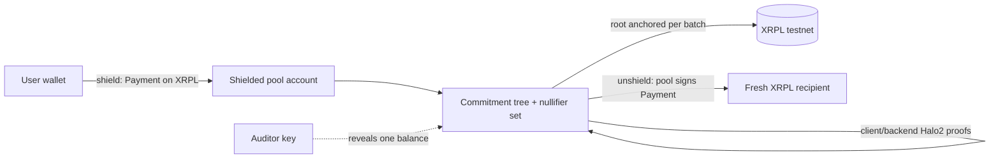

# Confidant — Technical Spec

A testnet shielded pool for one XRPL token, where internal transfers are unlinkable
on-ledger and an auditor key reveals exactly one holder's balance.

**Objective:** demonstrate, live on testnet, a shield → private transfer → unshield →
auditor-reveal flow where the internal transfer is invisible on the block explorer.

**Non-goals:** multi-asset pool, confidential AMM, ZKML, on-chain proof verification,
FROST wiring, WASM proving. Mainnet is a stretch, attempted only if the testnet demo is solid.

---

## Architecture



Value moves only as XRPL Payments to/from the pool account. Unlinkable transfers happen as
note-commitment / nullifier state changes proven in zero knowledge; the tree root is anchored
to the ledger each batch so anyone can verify the pool never double-spent. The auditor key
decrypts exactly one holder's notes on demand.

**Verification venue — A (chosen):** proofs verified off-chain and published, with the
commitment-tree root anchored to the ledger (Payment memo) each batch; anyone can re-verify
against the anchored root. Keeps everything on XRPL, one environment, no EVM/Solidity.

## Stack

- **Rust backend + API** — crypto core (reused Halo 2 circuits), commitment tree + nullifier
  set, proving, auditor decrypt. XRPL-agnostic. The reused circuit is the **Zcash Orchard Action
  circuit, unchanged**: crate `orchard` 0.15.5, `BundleVersion::orchard_v2()` /
  `OrchardCircuitVersion::FixedPostNu6_2` (the circuit on Zcash mainnet since NU6.2); a verifier
  builds that verifying key. Core crate: `core/` (`confidant-core`). Design + audit record:
  `docs/audit/REQ-pool-design-2026-10-04.md`, `RESP-pool-design-2026-10-04.md`.
- **React/TS front-end + `xrpl.js`** — owns all XRPL: shield/unshield Payments, custody
  signing, root-memo anchoring, reading the ledger. Minimal UI; use the real testnet explorer
  (https://testnet.xrpl.org) rather than building a mock.

## Easiest-path decisions

- **Testnet first** (faucet accounts, no real value); mainnet only if time.
- **Custody (v2):** the pool account is controlled by an XRPL **SignerList quorum (k-of-N)** of
  independent verifiers, master key disabled. v1 (single regular key) only as the demo fallback.
- **Proving on the client (v2):** the user's keys and plaintext never leave the user's machine.
  The wallet is a native local process (no WASM for the hackathon); the service only verifies.
- **Root anchor** = a Payment memo carrying the tree root each batch.
- **Pre-populate the pool** — a script shields from many testnet accounts so the pool has a
  believable anonymity set and unshields aren't 1:1 linkable on stage.

## Privacy — claims & on-stage framing

- **Claim:** parity with Tornado/Railgun (hide the internal graph) on XRPL + selective disclosure.
- **Hidden:** sender / receiver / amount of internal hops (off-ledger; only the root anchored).
- **Public (inherent to any pool):** shield/unshield amounts + external addresses. Privacy =
  anonymity set, simulated with pre-funded testnet accounts + fixed denominations.
- **Trust model (v2, in progress — see §v2 below).** Notes are **non-custodial**: keys and plaintext
  stay on the client, nobody else can spend a holder's notes or read them. The **pool account and
  proof verification are federated**: a k-of-N quorum of independent verifiers, each re-checking the
  proof and the deposit on-ledger before signing a payout or an anchor. Backing is therefore
  federated, not cryptographic: **collusion of k signers can drain the pool account** (it still
  cannot forge a spend of anyone's note). State is reconstructible from the ledger alone. Until v2
  lands, v1 is **custodial** (one operator holds every key, sees everything, can spend everything,
  vouches for backing) and must be labeled so. Consensus-level verification needs the amendment in
  §Amendment sketch; "a TEE removes the operator from the trust base" is the **only** place TEE is
  mentioned — a production footnote, never in the demo mechanics.
- **Endpoint correlation (limitation, stated plainly).** The pool hides the *internal* graph. It does
  **not** hide that someone shielded X and later someone unshielded X: with a small or empty anonymity
  set, amount + timing + external address correlate a deposit to a withdrawal. An empty pool at launch
  gives the first operations ~no privacy — pre-populate it before the demo.
- **What the auditor key reveals.** The auditor key is the holder's Orchard full viewing key. It
  discloses that holder's **complete activity** — receipts, change, which notes were spent, and the
  recipients and amounts of their outgoing transfers — and current balance; nothing about
  transactions the holder was not a party to.
- **Don't say:** "fully anonymous / untraceable / trustless today." **Do say:** "the mechanism
  that hides the graph on XRPL, with compliance built in; scale, distribution and TEE are the roadmap."

## API contract (Rust backend ↔ TS front-end)

v1 contract (custodial operator) is kept below for reference; **v2 replaces it with bundle
submission**: the client builds, proves and signs every bundle; the service only verifies.

| v2 method + path | Purpose | Request | Response |
| --- | --- | --- | --- |
| `GET /log?from=N` | public bundle log (the mirror) and current state | — | `records[]`, `root`, `anchoredRoot`, `leafCount`, `nullifierCount` |
| `POST /submit/shield` | accept a client-built shield after the deposit is validated | `bundle` (record JSON), `depositTxHash` | `Accepted {bundleIndex, firstLeaf, newRoot}` |
| `POST /submit/transfer` | accept a client-built private hop | `bundle` | `Accepted` |
| `POST /submit/unshield` | accept a client-built exit; the quorum then pays `destination` | `bundle`, `destination` | `Accepted` + `payout {amount, destination}` |
| `POST /audit/reveal` | convenience over the public log | `viewingKey` (holder's FVK) | `balance`, `notes[]` (a holder's auditor can run this locally instead) |

No `owner`, no `senderAuth`: the spend-authorization signatures inside the bundle are the
authorization. **Deposit binding:** the deposit Payment's memo (`confidant/shield`) carries the
BLAKE2b-256 hash of the shield bundle; a verifier accepts the shield only if `delivered_amount ==
−valueBalance`, the memo hash equals the bundle hash, and that deposit was not consumed before.

v1 contract (reference):

| Method + path | Purpose | Request | Response |
| --- | --- | --- | --- |
| `POST /shield` | after the FE submits the deposit Payment, mint a note | `amount`, `token`, `owner`, `depositTxHash` | `commitment`, `leafIndex`, `newRoot` |
| `POST /transfer` | one private internal hop (spend → new notes) | `spendNoteId`, `outputs:[{amount,owner}]`, `senderAuth` | `nullifier`, `proof`, `newCommitments[]`, `newRoot` |
| `POST /unshield` | spend a note to exit to an XRPL address | `spendNoteId`, `destination`, `senderAuth` | `nullifier`, `proof`, `newRoot`, `payout:{amount,token,destination}` (+ optional `signedTxBlob`) |
| `POST /audit/reveal` | a holder's viewing key reveals that holder's activity + balance | `auditorKey` (the holder's full viewing key, 96 bytes hex) | `balance`, `notes:[{direction,amount,leafIndex,bundleIndex,timestamp,spent,recipient?}]` |
| `GET /pool/state` | public pool state (no plaintext) | — | `root`, `anchoredRoot`, `leafCount`, `nullifierCount` |

Flow: FE submits the shield Payment → `/shield`. Private hop = `/transfer` (nothing hits the
ledger). FE reads `newRoot` and anchors it with a memo Payment. Unshield = `/unshield` → FE
builds + submits the pool→recipient Payment. Money shot = `/audit/reveal` next to the explorer.

## Data model

- **Note** `{ value, token, owner_pubkey, randomness }` — a unit of shielded value, kept secret.
- **Commitment** `C = Poseidon(value, token, owner_pubkey, randomness)` — public leaf appended on shield/transfer.
- **Nullifier** `N = Poseidon(note_secret, leafIndex)` — published on spend; the spent-set prevents double-spends.
- **Merkle tree** — incremental, leaves = commitments; `root` anchored to XRPL each batch.
- **Encrypted note** — contents encrypted to the owner's viewing key (Orchard note encryption).
  The **auditor key for a holder is that holder's full viewing key**, handed over at onboarding;
  `/audit/reveal` trial-decrypts the bundle log with it.
- **Transfer/unshield proof** (reused Halo 2 circuit) proves: spent commitment ∈ tree (membership),
  spender knows the secret, nullifier correctly derived, and value conserved (Σ in = Σ out, no overflow) —
  revealing none of the values or owners.

## Repo layout

```
core/         Rust lib `confidant-core`: reused Orchard circuit (dep), commitment tree, nullifier
              set, prover/verifier, auditor reveal, bundle log + snapshot  (crypto lead)
backend/      Rust (axum): the 5 endpoints, thin wrapper over `confidant-core`  (API/XRPL lead)
frontend/     React/TS + xrpl.js — UI, explorer links, tx build/submit        (API/XRPL lead)
scripts/      testnet faucet funding + pool pre-population
docs/audit/   REQ/RESP design + implementation review records
README.md, SPEC.md, CLAUDE.md
```

## Milestones (definition of done each)

- [ ] **M0 — pre-event prep (not judged).** Circuits compile and prove/verify a dummy spend;
  testnet pool account + N funded accounts via faucet; repo scaffold; API stubs returning fixtures.
- [ ] **M1 — shield.** A Payment into the pool → `POST /shield` → commitment in the tree;
  `GET /pool/state` shows the new leaf.
- [ ] **M2 — private transfer.** `POST /transfer`: one spend → new commitments, Halo 2 proof
  verifies, nullifier recorded, root advances; nothing on the ledger.
- [ ] **M3 — anchor.** Tree root written to testnet via a memo Payment; re-verifiable against it.
- [ ] **M4 — unshield.** `POST /unshield` → proof + a pool→fresh-address Payment (single-key signed) → funds arrive.
- [ ] **M5 — disclosure + demo.** `POST /audit/reveal` shows one balance; the minimal UI drives
  shield→transfer→unshield→reveal; the demo script is rehearsed on the real explorer.

## Definition of done (the demo passes)

Live on testnet, end to end, narratable in under a minute: a **shield**, a **private transfer
that is invisible on the explorer**, an **unshield to a fresh address**, and an **auditor-key
reveal** of exactly one balance. Everything past that (mainnet, SignerList, Proof-of-Innocence)
is a bonus.

## Critical dependency

M2 is the whole gamble: the **reused Halo 2 circuits must drop in without a rewrite.** Validate
that at M0 — if the circuits need surgery, cut transfer proving to a stub and pivot the demo to
"shield → anchored commitments → auditor reveal," so there is always a working story.

## Demo script (~45 seconds)

Pool pre-funded with many testnet accounts; drive it next to the real testnet explorer.

1. **Hook** — "XLS-96 hides the amount. The chain still shows who paid whom. Watch us hide that too."
2. **Shield** — "Alice shields 100 into the pool — an ordinary XRPL payment." (explorer shows the deposit)
3. **Private transfer** — "Now she pays Bob inside the pool. Here's the ledger… nothing. No
   sender, no receiver, no amount — just a root commitment." (explorer shows only the root memo)
4. **Unshield** — "Bob withdraws to a fresh address. Unlinkable to Alice's deposit among every
   account in the pool." (explorer shows pool → fresh address)
5. **Money shot — selective disclosure** — "Compliance: we hand a regulator one viewing key. It
   reveals exactly Bob's balance — and nothing else." (auditor reveal on screen)
6. **Close** — "Private on XRPL, auditable on demand. Today it's a pool; here's the XLS that makes it native."

## Amendment sketch (Protocol Innovation)

**XLS-96 → Shielded MPT — from confidential *amounts* to a confidential *graph*.**

- **Gap:** XLS-96 encrypts amounts but ships "no sender or receiver anonymity, no transaction unlinkability."
- **Proposal:** extend XLS-33 MPTs with a native commitment tree + nullifier set (Zcash/MASP
  model) as ledger objects, and carry over XLS-96's holder/issuer/auditor key model so selective
  disclosure is native.
- **New primitives:** `MPTShield`, `MPTTransfer` (nullifier + proof), `MPTUnshield`; a per-issuer
  `ShieldedMPT` object holding the Merkle root + nullifier set.
- **Trust model:** no operator — the ledger maintains the tree and nullifiers; validators verify
  the proof. Auditor key is a first-class field.
- **Activation:** XLS → amendment → >80% of UNL validators for two continuous weeks. The running
  pool is the proof it works before the validators vote.
- **Open questions:** proof system cheap enough for on-ledger verification (Halo 2 vs a
  pairing-based SNARK with a verify precompile); nullifier-set storage/pruning in XRPL's object
  model; post-quantum from day one vs secp256k1 + migrate.

## v2 — trust-minimized architecture (decided 2026-10-05; implementation tracked in ROADMAP §5a)

Goal: decentralization comparable to Railgun/Tornado on today's XRPL — not better, because no
on-ledger party can verify a Halo 2 proof without an amendment. The four trust functions the v1
operator bundles are split apart:

| Trust function | v1 (custodial) | v2 |
| --- | --- | --- |
| Who holds spending keys / sees plaintext | the operator | the holder's **Wallet** (local process); verifiers see ciphertexts, nullifiers, commitments, proofs — what the chain sees in Zcash |
| Who controls the pool account | one regular key | XRPL **SignerList k-of-N** of independent verifiers, master key disabled |
| Who verifies proofs and keeps state | the operator, in memory | every signer runs a **Verifier**; state is also written to the ledger per op and rebuildable by anyone |
| Who vouches for backing | the operator | each signer validates the deposit on-ledger **and** its memo binding before signing; one deposit backs at most one shield |

**Components.** `Wallet` (keys, own notes tracked by scanning the public log, build / prove / sign;
needs the log to compute witnesses). `Verifier` (tree, nullifier set, consumed-deposit set, bundle
log, verify-and-apply, anchor-memo codec, rebuild from memos + mirror). Coordinator (any party:
collects ≥ k signer signatures over the multisigned anchor / payout transactions and submits them).

**Flows.** *Shield:* wallet builds the shield bundle (output to its own address) → computes the
bundle hash → sends the deposit Payment with memo `confidant/shield` = hash → submits `{bundle,
depositTxHash}` to a verifier. Each signer: deposit validated on-ledger (Payment, Destination =
pool, `delivered_amount == −valueBalance`), memo hash == bundle hash, deposit unconsumed, then the
common verify tail; marks the deposit consumed; signs the anchor. *Transfer:* wallet syncs the log,
builds spends with witnesses against a known anchor, submits the bundle; signers verify and sign
the anchor. *Unshield:* bundle + destination; signers verify (sighash binds destination and
amount) and sign payout + anchor (one XLS-56 Batch where enabled, else anchor first).

**Per-op anchor memo** (`confidant/anchor`, ≤ 1 KB):
`version(1) ‖ op(1) ‖ root(32) ‖ bundleHash(32) ‖ extLen(1) ‖ ext ‖ n(1) ‖ n × (nullifier(32) ‖ cmx(32))`,
where `ext` is the 32-byte deposit tx hash for a shield, the ASCII destination for an unshield,
empty for a transfer. `bundleHash = BLAKE2b-256(personal "ConfidantBundle")` over the canonical
bundle bytes (anchor, flags, value balance, actions, proof, binding signature; not the metadata).
Anyone rebuilds a verifier: read the pool account's transactions → memos → fetch each bundle by
hash from any mirror (`GET /log`) → verify hash and proof → apply → the root must equal the memo's.

**Relaying.** Any client may submit to any verifier; any party may run a verifier from the ledger
and a mirror; the coordinator can delay but cannot steal, mint or forge.

**What stays weaker than Tornado/Railgun.** Proof verification is by k honest signers, not by
consensus; collusion of k can drain the pool account. Liveness depends on k signers. Fixing that is
the amendment above. What is better: Halo 2 needs no trusted setup.
