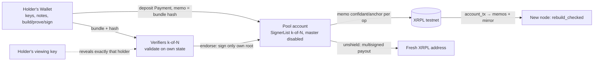

# Confidant — Technical Spec

> Status: as of **2026-10-05, `main` after PR #8** — the **v2 trust-minimized architecture is
> implemented in the core and exercised on XRPL testnet**. Where this document and the code
> disagree, the code, its tests and `docs/audit/` win. Work status per step: [`ROADMAP.md`](./ROADMAP.md).
> The detailed Russian edition is [`SPEC.ru.md`](./SPEC.ru.md). Mentions of v1 (a single custodial
> operator) are history, not the current state.

---

## 0. In one screen

**Confidant** is a compliant shielded pool for the XRP Ledger. XLS-96 hides *amounts*; the
transaction *graph* (who paid whom) stays public. Confidant hides the graph: a transfer inside the
pool leaves no sender, receiver or amount on the ledger — only a memo carrying the commitment-tree
root and the operation's public effects. Privacy stays **auditable on demand**: a holder's viewing
key reveals exactly that holder's activity and balance, and nothing about anyone else's.

**Objective:** demonstrate live on testnet **shield → private transfer → unshield → auditor
reveal**, with the private transfer invisible on the block explorer.

**Trust model (v2):** notes are **non-custodial** — keys and plaintext never leave the holder's
wallet; the pool account and proof verification sit with a **k-of-N quorum of independent
verifiers** (XRPL SignerList); state is **reconstructible from the ledger** by anyone. **Collusion
of k signers can drain the pool account but cannot spend anyone's notes** — the real difference
from Tornado/Railgun, and a dated one: today's XRPL has no on-ledger Halo 2 verifier.

**Non-goals:** multi-asset pool, confidential AMM, ZKML, on-ledger proof verification (needs the
amendment in §15), FROST wiring, WASM proving in the browser. Mainnet is a stretch, only if the
testnet demo is solid.

**Branding.** Formal name `Confidant` for the pitch, slides and institution-facing material; the
stylized wordmark `C0nf!d@nt` only for the banner, demo and social flair; identifiers are ASCII
`confidant`.

---

## 1. Context and constraints

| Constraint | Consequence |
|---|---|
| AI & Fintech XRP Ledger Hackathon, NYC, Oct 24–25, 2026 | Simplifications allowed; scope fixed: one thing done well |
| "Only what you build during the hackathon counts" | The core (`core/`) and the harness are pre-event preparation on a pre-existing library (the Zcash Orchard circuit). The judged work is the XRPL integration built on-site. Be honest about the split |
| Testnet first | All Payments, accounts and keys are testnet. Mainnet only by decision after a solid testnet demo |
| Honest labels | Never claim "fully anonymous / untraceable / trustless today / private from the operator". What to say and not to say: §4 |
| TEE is a production footnote only | Never lead the demo with TEE; lead with ZK, which judges recognize |
| Possibly public repo | Roles only, never real names, in git; no keys, seeds, `.env` or wallet files |

---

## 2. Roles

| Role | Owns | Where |
|---|---|---|
| **Crypto/ZK lead** | the Rust core: `Wallet`, `Verifier`, circuit reuse, tree, nullifiers, deposit binding, anchor memos, reveal; the **quorum services** (`backend/`: Rust verifier node with scanner and `/endorse`, Node signer sidecars, coordinator, setup/launch scripts); the CLI test tool and the e2e harnesses; tests, coverage, the audit cycle | `core/`, `backend/`, `e2e/testnet/`, `docs/audit/`, `docs/CORE-API.md`, `docs/E2E.md`, `docs/NODE-OPERATOR.md` |
| **API/XRPL lead** (repo owner) | the user-facing layer: local wallet UX, the deposit Payment with memo from the user's account, the UI over the coordinator, pre-population, demo script, pitch | `frontend/`, `scripts/` |
| **Audit session** | answers `REQ-*` with `RESP-*` verdicts; never merges | `docs/audit/` (committed verbatim by the lead) |

---

## 3. Architecture



Value moves only as XRPL Payments into and out of the pool account. Inside the pool, transfers are
commitment / nullifier state changes proven in zero knowledge **on the holder's device**. After
every accepted operation the quorum writes a memo Payment carrying the tree root, the bundle hash,
the nullifiers and the commitments, so anyone can rebuild the pool state from the ledger and
confirm it never double-spent.

### Flows (v2)

1. **Shield.** The wallet builds and proves a bundle paying its own address and computes the
   **bundle hash**. The user sends the deposit Payment to the pool with memo `confidant/shield` =
   hash. The wallet submits `{bundle, depositTxHash}`. Every verifier looks the deposit up on-ledger
   itself (validated, Payment, Destination = pool, `delivered_amount`), checks memo == bundle hash
   and that the deposit is unconsumed, then accepts; a signer signs the anchor only for the root it
   computed itself.
2. **Private transfer.** The wallet syncs the public log (`GET /log`), builds spends with
   witnesses, outputs and change, proves and signs; verifiers accept. Only the anchor memo reaches
   the ledger.
3. **Unshield.** The wallet builds a bundle with `value_balance = amount` whose signatures bind the
   destination and the amount; verifiers accept; the quorum multisigns the anchor and then the
   Payment pool → destination.
4. **Reveal.** The holder hands their full viewing key to the auditor; `reveal` runs on any verifier
   or locally over the public log.
5. **A new node joins.** `account_tx` of the pool account → anchor memos in order → bundles from any
   mirror by hash → `rebuild_checked`: every proof, every signature and every deposit re-verified;
   the root must equal the last memo's.

---

## 4. Trust model and privacy claims

### 4.1 The four trust functions

| Function | v1 (was: custodial) | v2 (implemented) |
|---|---|---|
| Who holds spending keys / sees plaintext | the operator | the holder's **Wallet**; verifiers see ciphertexts, nullifiers, commitments and proofs — what the chain sees in Zcash |
| Who controls the pool account | one regular key | XRPL **SignerList k-of-N** of independent verifiers, master key disabled |
| Who verifies proofs and keeps state | the operator, in memory | every signer runs its own **Verifier**; state is on the ledger per op and rebuildable by anyone |
| Who vouches for backing | the operator | every signer validates the deposit on-ledger **and** its binding to the bundle; one deposit backs at most one shield; a joining node re-validates every deposit (`rebuild_checked`) |

### 4.2 Hidden, public, limits

| | |
|---|---|
| **Hidden on ledger** | sender, receiver and amount of every internal hop; XRPL only sees anchor memos with commitments, nullifiers, the bundle hash and the root |
| **Public and inherent** (any pool) | shield/unshield amounts and external XRPL addresses; the number of actions per op (always ≥ 2, padded); timing |
| **Endpoint correlation (limitation)** | the pool hides the *internal* graph; it does **not** hide that someone shielded X and later someone unshielded X. With a small or empty anonymity set, amount + timing + external address correlate a deposit to a withdrawal. Real privacy = anonymity set + fixed denominations + delay |
| **Empty pool at launch** | the first operations have ~no privacy — pre-populate the pool from many testnet accounts before the demo |
| **What the auditor key reveals** | the auditor key is the holder's **full viewing key**. It discloses that holder's **complete activity** — receipts, change, which notes were spent, and the recipients and amounts of their outgoing transfers — and current balance; nothing about transactions the holder was not a party to. "Balance only" would be false |

### 4.3 Say / don't say

- **Say:** "notes are non-custodial: plaintext never leaves the client and nobody else can spend a
  holder's notes; the pool account and proof verification sit with a k-of-N quorum of independent
  verifiers; state is reconstructible from the ledger; **collusion of k signers can drain the pool
  account but cannot spend anyone's notes**. We verify by quorum because today's XRPL has no
  on-ledger Halo 2 verifier; an amendment adding one (§15) upgrades this to on-ledger verification
  without changing notes, proofs or memos. Halo 2 has no trusted setup; Railgun's Groth16 has one."
- **Do not say:** "fully anonymous / untraceable / trustless today / private from the operator".
  "Custodial" now describes v1 and the federated custody of the pool account by the quorum, nothing
  else.

CI checks that the label markers are present in `SPEC.md`, `README.md` and `SPEC.ru.md` and that no
over-claim word appears outside the do-not-say rule.

---

## 5. The cryptographic core (`core/`, crate `confidant-core`)

### 5.1 The reused circuit

The "reused Halo 2 circuits" are the **Zcash Orchard Action circuit, unchanged**:

| Parameter | Value |
|---|---|
| Crate | `orchard = 0.15.5`, features `circuit`, `multicore`, `std` |
| Bundle version | `BundleVersion::orchard_v2()` — the Orchard pool under protocol version 2 |
| Circuit version | `OrchardCircuitVersion::FixedPostNu6_2` — the circuit on Zcash mainnet since NU6.2 |
| Notes | V2, `OrchardDomain` encryption |
| Flags | spends + outputs + cross-address transfers enabled; a shield uses `SPENDS_DISABLED` |
| Bundle type | `BundleType::DEFAULT` — padded to ≥ 2 actions |
| Proving/verifying keys | built from the circuit at process start; no trusted key artifact |

Why `orchard_v2`: `orchard_v3` forbids cross-address outputs; `ironwood_v3` only matters for interop
with another project's in-enclave prover. Audit: Q-POOL-1, no objection.

Per action the circuit and bundle enforce: membership of the spent commitment under the anchor
(Sinsemilla tree, depth 32); knowledge of the spending key (`rk`, spend-auth signature over the
sighash); correct nullifier; correct output commitment; hiding value commitments that the
**binding signature** ties to the public `value_balance`.

### 5.2 Two types

| Type | Runs where | Holds | Does |
|---|---|---|---|
| **`Wallet`** | the holder's machine (a local process the UI talks to over localhost) | the spending key, the holder's notes, a replica of the public state | `sync(log)` — re-verifies every new record into the replica, finds own notes by trial decryption, marks spent ones, refuses a log that does not extend what it synced; `build_shield / build_transfer / build_unshield` → `Prepared { record, hash }` |
| **`Verifier`** | every signer, and anyone else who wants one | public state only: tree, nullifier set, consumed-deposit set, bundle log, anchored root | `submit_shield / submit_transfer / submit_unshield`, `replay`, **`endorse`**, `anchor_memo`, `check_memo`, `rebuild` / `rebuild_checked`, `reveal`, key-free `snapshot` / `restore` |

### 5.3 Notes, commitments, nullifiers, tree

- **Note** — an Orchard note: recipient address, `u64` value, `rho`, `rseed`. One token per pool.
- **Commitment** `cmx` — a tree leaf. **Nullifier** `nf` — published on spend; a repeat is refused.
- **Tree** — Sinsemilla Merkle tree, depth 32 (`shardtree`), plus a cloneable `Frontier` mirror a
  signer uses to predict the root a transition would produce without mutating. **All** `cmx` of an
  accepted bundle are appended, dummies included; one checkpoint per bundle; the root history is the
  set of acceptable anchors. After every append the mirror's root and the tree's root are compared
  and a divergence aborts the process (release check).
- **Sets**: every nullifier of every accepted bundle (dummy spends included) and the **consumed
  deposits** (deposit tx hashes that already back a shield).

### 5.4 Operations as bundles

| Operation | Contents | `value_balance` | External context in the sighash |
|---|---|---|---|
| **shield**(amount) — built by the wallet | one output to the wallet's address, spends disabled | `−amount` | **empty**: the deposit ↔ bundle binding lives in the deposit memo (bundle hash), the consumed-deposit set and the anchor memo |
| **transfer**([(address, amount)]) | spends (greedy note selection, witnesses at the current anchor), outputs, change to the internal scope | `0` | none |
| **unshield**(amount, destination) | spends + change, no external output | `+amount` | `destination ‖ amount` |

Limits: up to 8 recipients per transfer, positive amounts, `u64` overflow refused (`AmountOverflow`).

### 5.5 Bundle hash and sighash

**Bundle hash** = `BLAKE2b-256(personal "ConfidantBundle")` over the canonical bytes: anchor ‖
flags ‖ `value_balance` ‖ every action (nullifier, rk, cmx, cv_net, epk, enc, out, spend-auth sig)
‖ proof ‖ binding signature. Metadata (index, timestamp, leaf, external context) is excluded. This
is what the deposit memo and the anchor memo commit to.

**Sighash** = `BLAKE2b-256(personal "ConfidantSigHash")(bundle.commitment(V5) ‖ op_tag ‖
external_ctx)`. The op tag keeps a bundle of one operation from being presented as another; the
unshield context binds the payout to the destination and the amount, the amount always taken from
the bundle's own `value_balance`.

### 5.6 Deposit binding (backing)

A verifier accepts a shield only if: (a) the XRPL side found the deposit as a validated Payment to
the pool account; (b) `delivered_amount == −value_balance`; (c) the `confidant/shield` memo equals
the hash of the submitted bundle; (d) the deposit tx hash is not in the consumed set. The deposit
is then marked consumed. This closes the race: a stranger cannot claim someone's deposit, because
the deposit backs only the bundle with that hash; a replayed bundle is refused on its nullifiers
even earlier, and a second deposit under the same bundle is the depositor's loss, not pool
inflation.

### 5.7 Verify tail and apply

`verify` (pure): value-balance sign per op → vouched amount == `value_balance` (a non-zero vouched
amount for a transfer is a caller error) → anchor ∈ history → nullifiers unspent and unique
(**before** the SNARK, so a replay costs a set lookup) → `verify_proof` → every action's `rk`
signature → binding signature. `check_deposit_state` (shields): a deposit is named and unconsumed.
`apply_verified` is the only mutation and is reached only after both — from `submit_*`, `replay`,
`rebuild*` and `endorse`. Any refusal leaves state unchanged.

Recorded caveat (audit, PR #2): the nullifiers-before-proof order leaks nothing only while the
nullifier set is public — and it now is, on-ledger in every memo.

### 5.8 A signer never blind-signs: `endorse`

`Verifier::endorse(submission, proposed_memo)` is a signer's whole duty in one call: the
coordinator's memo must describe exactly this submission (op, external context, bundle hash,
nullifier/cmx list); for a shield the signer re-checks the deposit binding itself; then
`check_deposit_state` and `verify` on **its own** state; then the root the transition produces on
**its own** tree (`root_after`, from the `Frontier` mirror) must equal the proposed root — only then
the transition is applied and the signer signs. Any disagreement refuses with state unchanged. A
signer never signs a root handed to it.

### 5.9 Anchor memo and rebuild from the ledger

Memo type `confidant/anchor`, ≤ 1 KB:

```
version(1) ‖ op(1) ‖ root(32) ‖ bundleHash(32) ‖ extLen(1) ‖ ext ‖ n(1) ‖ n × (nullifier(32) ‖ cmx(32))
```

`ext` is the UTF-8 external context: deposit tx hash for a shield, destination for an unshield,
empty for a transfer. A 2-action bundle is 196–260 bytes. The decoder hard-rejects an unknown version
or op, truncation, trailing bytes and non-UTF-8.

**`rebuild(memos, mirror)`** — a new node: bundles are fetched from any mirror by hash, every proof
and signature is re-verified, the root after each must equal the memo's, nullifiers and commitments
must equal the memo's list. Note validity rests on nobody but this node. **`rebuild_checked(memos,
mirror, deposits)`** additionally requires, for every shield, the deposit facts from the ledger and
refuses a shield whose deposit is missing, delivered a different amount or commits to another
bundle — so the node confirms pool backing itself. A signer must join this way; a node without
deposit checks trusts the quorum on backing, which adds no risk beyond the conceded k-collusion.

### 5.10 Keys, reveal, persistence

- `Wallet::info()` → `{ address (43 bytes hex), viewingKey (96 bytes hex) }`. The holder hands the
  viewing key to their auditor themselves.
- `Verifier::reveal(viewingKey)` — trial decryption of the log with the holder's incoming viewing
  keys (both scopes), spent status via `nk`, outgoing notes via `ovk`. Dummy outputs are never
  attributed to anyone.
- `WalletSecret` — the wallet file with the spending key (mode 0600, gitignored, loud CLI warning).
  `VerifierSnapshot` — public, key-free; `restore` replays the log through the same tail.

### 5.11 Performance (laptop, release)

| Operation | Time |
|---|---|
| Circuit parameters (once per process) | ≈ 2.5 s |
| Wallet: build + prove a 2-action bundle | ≈ 0.9 s (+ ≈ 0.45 s per extra action) |
| Verifier: accept a bundle | ≈ 10 ms |
| `sync` / `rebuild` | ≈ 10 ms per record |
| Anchor memo | 196–260 B for 2 actions, ≤ 1 KB up to 8 |

---

## 6. API contract v2 (backend over `Verifier`)

| Method + path | Purpose | Request | Response |
|---|---|---|---|
| `GET /log?from=N` | public log (the mirror) and state | — | `records[]`, `root`, `anchoredRoot`, `leafCount`, `nullifierCount`, `consumedDeposits` |
| `POST /submit/shield` | accept a client-built shield after the deposit is validated | `bundle`, `depositTxHash` | `Accepted {bundleIndex, firstLeaf, newRoot, bundleHash, nullifiers[], commitments[]}` |
| `POST /submit/transfer` | accept a client-built private hop | `bundle` | `Accepted` |
| `POST /submit/unshield` | accept a client-built exit; the quorum pays | `bundle`, `destination` | `Accepted` + `payout {amount, destination}` |
| `POST /audit/reveal` | convenience over the public log | `viewingKey` | `balance`, `notes[]` |

No `owner`, no `senderAuth`: the spend-authorization signatures inside the bundle are the
authorization. Implemented in `backend/`: the **verifier node** (`confidant-node`, Rust) serves
these plus `POST /endorse {submission, proposedMemoHex}` (idempotent; the node re-reads a shield's
deposit from the ledger itself) and `POST /anchored`; a **signer sidecar** (Node, xrpl.js) holds one
signer's key and signs an anchor/payout only after *its own* node endorsed and the transaction's
shape matches that endorsement; the **coordinator** (Node) accepts `POST /submit/*`, fans out, assembles
≥ k signatures and submits anchor then payout. Core call mapping and error → HTTP mapping:
`docs/CORE-API.md`; services: `backend/README.md`.

---

## 7. The XRPL side (API/XRPL lead)

Implemented in `backend/quorum/` (xrpl.js) and exercised by `e2e/testnet/run.mjs` and `run-services.mjs`; the front-end only needs the deposit Payment with the memo and calls to the coordinator.

- **Pool account.** `SignerListSet` with quorum k of N signer keys, then `AccountSet
  asfDisableMaster`. Exercised on testnet with 2 of 3.
- **Deposit.** Payment user → pool **with memo `confidant/shield` = bundle hash** built by the
  wallet beforehand. Before accepting, every verifier looks the tx up: `validated`, `Payment`,
  `Destination` == pool, `meta.delivered_amount`, memo.
- **Anchoring.** After every accepted op, a multisigned Payment from the pool to a sink account
  (1 drop) with memo `confidant/anchor` = the anchor memo; only signers whose `endorse` succeeded
  sign. After validation, `anchored <root>`.
- **Payout.** After the anchor, a multisigned Payment pool → `payout.destination` for
  `payout.amount` (XLS-56 Batch not used: anchor first, payout second).
- **Scanner.** `account_tx` of the pool account → memos in order → `rebuild_checked` with the
  deposit facts looked up on-ledger for every shield.
- **Pre-population.** A script with N faucet accounts and fixed denominations.
- **Open decisions:** XRP vs. an issued/MPT token; fixed denominations; anchoring cadence (now per
  op); where the signer services run on stage.

---

## 8. Repository layout

```
core/src/   wallet.rs (Wallet), verifier.rs (Verifier, endorse, rebuild*), record.rs (record ⇄
            bundle, bundle hash), memo.rs (anchor memo), tree.rs (tree + Frontier), sighash.rs,
            keys.rs, reveal.rs, types.rs, error.rs
core/tests/ verifier.rs (negative suite v1 + v2), e2e_demo.rs (demo with two signers and a
            rebuilding node), common/
core/examples/ cli.rs (wallet and verifier roles — test tool), demo.rs
backend/node/  confidant-node: Rust verifier node (HTTP over Verifier, ledger reads, scanner, /endorse)
backend/quorum/ signer.mjs (sidecar: holds a signer key, signs only what its node endorsed),
               coordinator.mjs (k-of-N multisig, anchor then payout), setup-pool.mjs, start-all.mjs, lib.mjs
e2e/testnet/ XRPL testnet harnesses (xrpl.js): run.mjs (CLI-driven), run-services.mjs (through backend/)
docs/audit/  REQ/RESP of every round, INDEX.md
docs/CORE-API.md, docs/E2E.md, docs/NODE-OPERATOR.md
.github/workflows/check.yml  CI: fmt / clippy / tests (release) / 100% line coverage / hygiene / manual e2e
frontend/, scripts/   — the API/XRPL lead's area (not started)
README.md, SPEC.md, SPEC.ru.md, ROADMAP.md, CLAUDE.md
```

Stack: Rust core and backend; React/TS front-end with `xrpl.js`, which owns all XRPL. No Solidity,
no WASM, no `xrpl-rust`.

---

## 9. Milestones and status

| Milestone | Definition of done | Core + harness | API/XRPL/UI |
|---|---|---|---|
| **M0 — pre-event prep (not judged)** | circuit proves/verifies; pool account + accounts; scaffold | ✅ | ⬜ |
| **M1 — shield** | deposit with memo → `POST /submit/shield` → commitment in the tree; state shows the new leaf | ✅ | ⬜ |
| **M2 — private transfer** | `POST /submit/transfer`: spend → new commitments, proof verified, nullifier recorded; nothing on the ledger but the anchor | ✅ | ⬜ |
| **M3 — anchor** | an anchor memo per op, multisigned by the quorum; re-verifiable and rebuildable from the ledger | ✅ (testnet, twice) | ⬜ |
| **M4 — unshield** | `POST /submit/unshield` → multisigned payout to a fresh address | ✅ (testnet) | ⬜ |
| **M5 — disclosure + demo** | `POST /audit/reveal`; UI drives the script; rehearsed on the real explorer | ✅ reveal | ⬜ UI, demo |
| **v2 — trust minimization** | Wallet/Verifier, deposit binding, anchor memos, k-of-N, permissionless relaying | ✅ core (PR #8) · ✅ services (`backend/`) | ⬜ wallet UX, UI |

---

## 10. Definition of done and demo script

**Done** when, live on testnet: a **shield**, a **private transfer invisible on the explorer**, an
**unshield to a fresh address multisigned by the quorum**, and an **auditor reveal of exactly one
holder** are shown and narrated in under a minute. Everything else is a bonus.

The ~45-second script, pool pre-populated, real testnet explorer open:

1. **Hook** — "XLS-96 hides the amount. The chain still shows who paid whom. Watch us hide that too."
2. **Shield** — "Alice shields 100 into the pool — an ordinary XRPL Payment with a memo; the proof
   she built on her own machine." (explorer: the deposit and the anchor)
3. **Private transfer** — "Now she pays Bob inside the pool. Here's the ledger… only an anchor. No
   sender, no receiver, no amount." (explorer: the anchor memo)
4. **Unshield** — "Bob withdraws to a fresh address. Two of three independent verifiers signed the
   payout — none of them holds Bob's keys." (explorer: the multisigned Payment)
5. **Money shot — selective disclosure** — "Compliance: we hand a regulator one viewing key. It
   reveals exactly Bob's activity and balance — and nothing else."
6. **Close** — "Private on XRPL, auditable on demand, state on the ledger. Today it's a quorum;
   here's the XLS that makes verification native."

Wording must match §4: non-custodial notes, the quorum can drain the pool account, the internal
graph is hidden but not the endpoints, ZK first, TEE a footnote.

---

## 11. Testing and quality

- **Core tests:** 29 (22 integration in `core/tests/verifier.rs`, the e2e in
  `core/tests/e2e_demo.rs`, 6 unit). The whole v1 negative suite carried over to
  `Wallet`/`Verifier`; v2 additions: deposit binding (a stranger's bundle against someone's deposit,
  wrong amount, deposit reuse, duplicate in a log), bundle hash without metadata, memo codec
  (version, op, truncation, trailing bytes, UTF-8, 1 KB), rebuild (wrong mirror, wrong root, wrong
  actions, wrong external, missing/wrong deposit facts), wallet sync, signer (wrong root / hash /
  external / op / actions, re-pointed payout, lagging signer).
- **Mutation testing:** 27 guards — each removed in turn makes its test red; tables in
  `docs/audit/REQ-v2-core-impl-2026-10-05.md`. One redundant check was found hollow and removed.
- **Coverage:** lines 100%, functions 100% (`cargo llvm-cov`), gated in CI; regions ≈ 97%.
- **CI**: fmt, clippy `-D warnings`, tests in release, coverage, hygiene (key-shaped files, honest
  label markers in three documents, over-claim words), manual e2e job on testnet.
- **E2E on XRPL testnet** (`e2e/testnet/run.mjs`, two runs 2026-10-05): SignerList 2-of-3 with the
  master key disabled; deposit with the bundle hash, validated by the coordinator and every signer;
  3/3 signers on their own state; three multisigned anchors (196–260 B); a lying coordinator refused
  3/3; multisigned payout; reveal; a new node from `account_tx` with every deposit re-validated
  (wrong amount and missing facts refused); a lagging signer caught up. Links: `docs/E2E.md` and the
  PR #8 comments.

---

## 12. Security process

**REQ → RESP** cycle with the audit session: `docs/audit/REQ-<slug>-<date>.md` from the dev,
`RESP-<slug>-<date>.md` the verdict, committed verbatim. Verdicts: DESIGN-PASS / IMPL-PASS /
CONDITIONAL / FAIL. No core change merges without a PASS for its slice; index in `docs/audit/INDEX.md`.

| Unit | Verdict |
|---|---|
| Pool design v1 | DESIGN-PASS, conditions C1–C5 applied |
| Core v1 (M0) | IMPL-PASS; slices PR #2 and PR #3 — PASS |
| **Design v2** (split, deposit binding, memos, k-of-N) | **DESIGN-PASS**, conditions (signer validation in core, memo version hard-reject, label refinements) applied |
| **Core v2** | **IMPL-PASS**; its condition (backing on join) met in-core via `rebuild_checked`; root cross-check is a release assert |

Invariants pinned in code: `external_ctx` expects a positive unshield balance (every caller checks
the sign first); a `Frontier`/tree root divergence aborts. The backing-forcing question on every
value-releasing path is answered: every signer checks backing at acceptance and every node at join;
collusion of k signers is the conceded bound.

---

## 13. Open decisions and risks

- Pool token, denominations, anchoring cadence, where the signer services run — §7.
- Empty pool = no privacy for the first ops → pre-populate.
- Endpoint correlation with a small anonymity set → denominations + delay + pre-population.
- Liveness depends on k signers; on stage that is three processes instead of one — rehearse.
- Proof verification is not on-ledger — the ceiling without the amendment (§15).

---

## 14. Roadmap beyond the hackathon

- A pool-instance id in the sighash personalization (today cross-deployment replay is stopped by
  the anchor ∈ history check).
- `external_ctx` taking the unshield amount as `u64`, narrowed at the call site.
- A bounded anchor history; XLS-56 Batch for atomic anchor + payout.
- Distributed key generation for signers (FROST) instead of independent keys; TEE for signers as an
  extra layer.
- Fixed denominations and Proof-of-Innocence.
- The amendment for on-ledger Halo 2 verification — from quorum to consensus (§15).

---

## 15. Amendment sketch (Protocol Innovation)

**XLS-96 → Shielded MPT — from confidential *amounts* to a confidential *graph*.**

- **Gap:** XLS-96 encrypts amounts but ships "no sender or receiver anonymity, no transaction
  unlinkability".
- **Proposal:** extend XLS-33 MPTs with a native commitment tree + nullifier set as ledger objects;
  carry over XLS-96's holder/issuer/auditor key model.
- **New primitives:** `MPTShield`, `MPTTransfer` (nullifier + proof), `MPTUnshield`; a per-issuer
  `ShieldedMPT` object.
- **Trust model:** no quorum — the ledger keeps the tree and nullifiers, validators verify the proof;
  the auditor key is a first-class field. The notes, proofs and memo format of v2 carry over
  unchanged.
- **Activation:** XLS → amendment → > 80% of UNL validators for two continuous weeks. The running
  quorum pool is the proof it works before the vote.
- **Open questions:** cost of Halo 2 verification on-ledger vs. a pairing-based SNARK with a
  precompile; nullifier-set storage in XRPL's object model; post-quantum.

---

## 16. How v2 was decided (2026-10-05)

The original spec described a single operator holding every key, seeing plaintext, keeping state
in memory and vouching for backing. The owner's decision on 2026-10-05: leave that for
Railgun/Tornado-comparable decentralization on today's XRPL, within the week. The four steps:

| Step | Done | Status |
|---|---|---|
| 1. Keys and proving on the client | `Wallet` / `Verifier`; the API takes a ready bundle; deposit binding via the memo hash | ✅ core + node; ⬜ FE wallet UX |
| 2. State on the ledger | anchor-memo codec, `rebuild` / `rebuild_checked`, `account_tx` scanner in the node (`--rebuild`) | ✅ |
| 3. k-of-N quorum | `endorse` in core; node `/endorse`, signer sidecars, coordinator; SignerList 2-of-3 with master disabled on testnet | ✅ |
| 4. Permissionless relaying | any node accepts bundles and serves `GET /log`; `docs/NODE-OPERATOR.md` | ✅ |

Ceiling without an amendment and the wording — §4.3. Audit records: `REQ/RESP-v2-trust-minimized`,
`REQ/RESP-v2-core-impl` in `docs/audit/`.

---

## Appendix A. Glossary

| Term | Meaning |
|---|---|
| Shield / unshield | entry by an ordinary Payment with a memo / exit by a multisigned Payment of the quorum |
| Note | a unit of shielded value (address, value, `rho`, `rseed`) |
| Commitment `cmx` | the public tree leaf hiding a note |
| Nullifier `nf` | published when a note is spent; a repeat is a double-spend |
| Anchor | the tree root a bundle was built against; every root in the history is accepted |
| Bundle | one operation = Orchard actions + proof + signatures |
| Bundle hash | BLAKE2b-256 of the canonical bundle bytes; what the deposit memo and the anchor memo commit to |
| Binding signature | ties the hiding value commitments to the public `value_balance` |
| Sighash | the message of the spend-auth and binding signatures; binds the op type and the payout destination |
| Anchor memo | the per-op ledger record: root, bundle hash, context, nullifiers, commitments |
| Endorse | a signer validating a submission on its own state and signing only its own root |
| Full viewing key | the holder's key revealing all their activity; the auditor key |
| Anonymity set | the pool's participants/notes among which a given transfer is indistinguishable |
| Backing | every shield is backed by exactly one real XRPL deposit; checked by every signer and by every node on join |

## Appendix B. The core CLI (test tool)

```
cli wallet   --file data/alice.wallet.json   init | info | balance <log> | sync <log>
                                             build-shield <amount> <out.json> [log]
                                             build-transfer <addrHex> <amount> <out.json> <log>
                                             build-unshield <amount> <destination> <out.json> <log>
cli verifier --state data/v1.verifier-state.json
             submit-shield <bundle.json> <depositTxHash> <delivered> <memoHashHex>
             submit-transfer <bundle.json> | submit-unshield <bundle.json> <destination>
             state | export-log <log.json> | anchored <rootHex> | reveal <viewingKeyHex>
             anchor-memo <index> | check-memo <index> <memoHex>
             rebuild <memos.json> <log.json> [deposits.json]
             endorse <submission.json> <memoHex>
```

Build: `cargo build --release --example cli`. The wallet file holds the spending key in cleartext:
written 0600, only to gitignored paths, with a warning on every run. Verifier state is public. It is
a stand-in for the backend in harnesses, not a product; the real services are §6 and
`docs/NODE-OPERATOR.md`.
