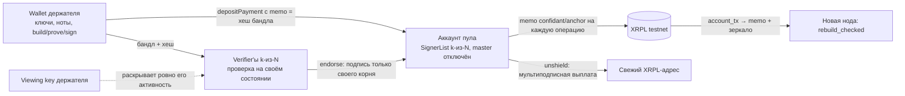

# Confidant — техническая спецификация (русская версия)

> Статус документа: подробная русская редакция [`SPEC.md`](./SPEC.md) по состоянию на
> **2026-10-05, `main` после PR #8** — архитектура **v2 с минимизацией доверия реализована в ядре и
> проверена на XRPL testnet**. При расхождениях приоритет у кода, тестов и записей в
> `docs/audit/`. Статус работ по шагам — в [`ROADMAP.md`](./ROADMAP.md). Где v1 (единый
> кастодиальный оператор) упоминается, это история решения, а не текущее состояние.

---

## 0. Кратко

**Confidant** — комплаентный shielded pool для XRP Ledger. XLS-96 скрывает *суммы*, но граф
переводов (кто кому платил) остаётся публичным. Confidant скрывает *граф*: внутри пула переводы
не оставляют на леджере ни отправителя, ни получателя, ни суммы — только memo с корнем дерева
коммитментов и публичными эффектами операции. Приватность остаётся **аудируемой по запросу**:
ключ просмотра держателя раскрывает ровно его активность и баланс — и ничего о чужих операциях.

**Цель:** вживую на testnet показать цепочку **shield → приватный перевод → unshield → раскрытие
аудитору**, где приватный перевод не виден в обозревателе блоков.

**Модель доверия (v2):** ноты **некастодиальны** — ключи и плейнтекст не покидают кошелёк
держателя; аккаунт пула и проверка доказательств у **кворума k-из-N независимых верификаторов**
(XRPL SignerList); состояние **восстанавливается из леджера** кем угодно. **Сговор k подписантов
может вывести средства пула, но не может потратить чужие ноты** — это главное отличие от
Tornado/Railgun, и оно датировано: на сегодняшнем XRPL нет верификатора Halo 2 на леджере.

**Не-цели:** мультиактивный пул, конфиденциальный AMM, ZKML, проверка доказательств на леджере
(требует amendment, §15), подключение FROST, WASM-доказательства в браузере. Mainnet — только
если testnet-демо надёжно.

**Названия.** Формальное имя `Confidant` — для питча, слайдов и всего, что обращено к
институциональной аудитории. Стилизованный логотип `C0nf!d@nt` — только для баннера, демо и
соцсетей. Идентификаторы (репозиторий, крейт, npm) — ASCII `confidant`.

---

## 1. Контекст и ограничения

| Ограничение | Следствие |
|---|---|
| Хакатон AI & Fintech XRP Ledger (Нью-Йорк, 24–25 октября 2026) | Упрощения допустимы; объём фиксирован: одна вещь, сделанная хорошо |
| «Засчитывается только то, что построено на хакатоне» | Ядро (`core/`) и харнес — подготовка до события на базе существующей библиотеки (схема Zcash Orchard). Судится XRPL-интеграция, собранная на месте. Об этом разделении говорить честно |
| Testnet first | Все платежи, аккаунты и ключи — testnet. Mainnet — только по решению после надёжного демо |
| Честные формулировки | Нельзя заявлять «полностью анонимно / неотслеживаемо / trustless сегодня / приватно от оператора». Что именно можно и нельзя говорить — §4 |
| TEE — только сноска о production | Никогда не вести демо через TEE и не ставить его в центр. Вести через ZK, которое судьи знают |
| Публичный репозиторий (потенциально) | В git — только роли, никаких реальных имён; никаких ключей, сидов, `.env`, файлов кошельков |

---

## 2. Роли

| Роль | Зона ответственности | Где в репозитории |
|---|---|---|
| **Крипто/ZK-лид** | Rust-ядро: `Wallet`, `Verifier`, схема, дерево, nullifier'ы, привязка депозитов, memo-анкоры, раскрытие; **кворумные сервисы** (`backend/`: Rust-узел верификатора со сканером и `/endorse`, Node-сайдкары подписантов, координатор, скрипты настройки и запуска); CLI-инструмент и e2e-харнесы; тесты, покрытие, аудиторский цикл | `core/`, `backend/`, `e2e/testnet/`, `docs/audit/`, `docs/CORE-API.md`, `docs/E2E.md`, `docs/NODE-OPERATOR.md` |
| **API/XRPL-лид** (владелец репозитория) | пользовательский слой: UX локального кошелька, депозитный Payment с memo с аккаунта пользователя, UI поверх координатора, предзаполнение, демо-сценарий, питч | `frontend/`, `scripts/` |
| **Аудит-сессия** | Отвечает на `REQ-*` вердиктами `RESP-*`; не мержит | `docs/audit/` (записи вносит лид дословно) |

---

## 3. Архитектура



Ценность движется только обычными XRPL-платежами в аккаунт пула и из него. Внутри пула переводы
— это изменения состояния «коммитменты нот + nullifier'ы», доказанные с нулевым разглашением
**на устройстве держателя**. После каждой принятой операции кворум записывает в memo-платёж
корень дерева, хеш бандла, nullifier'ы и коммитменты — так любой восстанавливает состояние пула из
леджера и убеждается, что двойных трат не было.

### Потоки (v2)

1. **Shield.** Кошелёк строит и доказывает бандл с выходом на свой адрес и вычисляет **хеш
   бандла**. Пользователь отправляет депозитный Payment в пул с memo `confidant/shield` = хеш.
   Кошелёк передаёт верификатору `{bundle, depositTxHash}`. Каждый верификатор сам проверяет депозит
   на леджере (валидирован, Payment, назначение — пул, `delivered_amount`), сверяет memo с хешем
   бандла, убеждается, что депозит ещё не потреблён, и только затем принимает; подписант подписывает
   анкор только того корня, который вычислил сам.
2. **Приватный перевод.** Кошелёк синхронизирует публичный лог (`GET /log`), строит траты со
   свидетелями, выходы получателям и сдачу себе, доказывает и подписывает; верификаторы проверяют и
   принимают. На леджер уходит только memo-анкор.
3. **Unshield.** Кошелёк строит бандл с положительным `value_balance = amount`, подписи которого
   привязаны к адресу назначения и сумме; верификаторы принимают; кворум мультиподписью отправляет
   анкор и затем Payment пул → адрес.
4. **Раскрытие.** Держатель передаёт аудитору свой full viewing key; `reveal` выполняется на любом
   верификаторе или локально по публичному логу.
5. **Вход новой ноды.** `account_tx` аккаунта пула → memo-анкоры по порядку → бандлы с любого
   зеркала по хешу → `rebuild_checked`: перепроверка каждого доказательства, каждой подписи, каждого
   депозита; корень обязан совпасть с последним memo.

---

## 4. Модель доверия и заявления о приватности

### 4.1 Четыре функции доверия

| Функция | v1 (было: кастодиально) | v2 (реализовано) |
|---|---|---|
| Кто держит ключи трат и видит плейнтекст | оператор | **Wallet** держателя; верификаторы видят шифротексты, nullifier'ы, коммитменты и доказательства — то же, что видит цепочка в Zcash |
| Кто управляет аккаунтом пула | один regular key | **SignerList k-из-N** независимых верификаторов, master-ключ отключён |
| Кто проверяет доказательства и ведёт состояние | оператор, в памяти | каждый подписант — свой **Verifier**; состояние пооперационно на леджере, восстанавливается кем угодно |
| Кто ручается за обеспеченность (backing) | оператор | каждый подписант сам проверяет депозит на леджере **и** его привязку к бандлу; один депозит обеспечивает не более одного shield; новая нода перепроверяет все депозиты при входе (`rebuild_checked`) |

### 4.2 Что скрыто, что публично

| | |
|---|---|
| **Скрыто на леджере** | отправитель, получатель и сумма каждого внутреннего перевода; на XRPL попадают только memo-анкоры с коммитментами, nullifier'ами, хешем бандла и корнем |
| **Публично и неустранимо** (любой пул) | суммы и внешние адреса shield и unshield; количество действий в операции (всегда ≥ 2, с паддингом); время |
| **Ограничение — корреляция концов** | пул скрывает *внутренний* граф, но **не** скрывает, что кто-то завёл X и позже кто-то вывел X. При малом или пустом множестве анонимности сумма + время + внешний адрес связывают депозит с выводом. Реальная приватность = размер множества анонимности + фиксированные номиналы + задержка |
| **Пустой пул при запуске** | первые операции имеют ~нулевую приватность. Перед демо пул **предзаполняется** многими testnet-аккаунтами |
| **Что раскрывает ключ аудитора** | ключ аудитора — **full viewing key держателя**. Он раскрывает **полную активность держателя**: поступления, сдачу, какие ноты потрачены, а также получателей и суммы его *исходящих* переводов — и текущий баланс. Он не раскрывает ничего о транзакциях, в которых держатель не участвовал. Формулировка «только баланс» неверна |

### 4.3 Что говорить и что не говорить

- **Говорить:** «ноты некастодиальны: плейнтекст не покидает клиента, никто другой не может
  потратить ноты держателя; аккаунт пула и проверка доказательств — у кворума k-из-N независимых
  верификаторов; состояние восстанавливается из леджера; **сговор k подписантов может вывести
  средства пула, но не может потратить чужие ноты**. Мы проверяем кворумом, потому что на
  сегодняшнем XRPL нет верификатора Halo 2 на леджере; amendment (§15) поднимет схему до проверки
  на леджере без изменения нот, доказательств и memo. У Halo 2 нет trusted setup, который есть у
  Groth16 в Railgun.»
- **Не говорить:** «полностью анонимно / неотслеживаемо / trustless сегодня / приватно от
  оператора». Слово «кастодиально» теперь относится только к v1 и к аккаунту пула как к
  федеративной кастодии кворума.

CI проверяет наличие обязательных маркеров этих формулировок в `SPEC.md`, `README.md` и этом файле
и отсутствие слов-переоценок вне правила «не говорить».

---

## 5. Криптографическое ядро (`core/`, крейт `confidant-core`)

### 5.1 Переиспользуемая схема

«Reused Halo 2 circuits» из английского SPEC — это **Action-схема Zcash Orchard без изменений**:

| Параметр | Значение |
|---|---|
| Крейт | `orchard = 0.15.5`, features `circuit`, `multicore`, `std` |
| Версия бандла | `BundleVersion::orchard_v2()` — пул Orchard с протокольной версией 2 |
| Версия схемы | `OrchardCircuitVersion::FixedPostNu6_2` — схема, работающая в Zcash mainnet с NU6.2 |
| Ноты | V2, шифрование `OrchardDomain` |
| Флаги | траты + выходы + межадресные переводы разрешены; shield строится с `SPENDS_DISABLED` |
| Тип бандла | `BundleType::DEFAULT` — паддинг до ≥ 2 действий |
| Ключи доказательства/проверки | строятся из схемы при старте процесса, никакого доверенного артефакта |

Почему `orchard_v2`: `orchard_v3` запрещает межадресные выходы, `ironwood_v3` нужен только для
совместимости с чужим in-enclave-прувером. Аудит: Q-POOL-1, без возражений.

Схема и бандл гарантируют на каждое действие: принадлежность тратимого коммитмента дереву под
якорем (Sinsemilla-дерево глубины 32); знание ключа трат (`rk`, подпись spend-auth над sighash);
корректный nullifier; корректный коммитмент выхода; скрывающие value-коммитменты, которые
**binding-подпись** связывает с публичным `value_balance`.

### 5.2 Два типа

| Тип | Где работает | Хранит | Делает |
|---|---|---|---|
| **`Wallet`** | у держателя (локальный процесс, с которым UI говорит через localhost) | ключ трат, свои ноты, реплику публичного состояния | `sync(log)` — перепроверяет каждую новую запись в реплику, находит свои ноты пробной расшифровкой, отмечает потраченные, отказывает логу, который не продолжает уже синхронизированный; `build_shield / build_transfer / build_unshield` → `Prepared { record, hash }` |
| **`Verifier`** | у каждого подписанта и у любого желающего | только публичное состояние: дерево, nullifier'ы, потреблённые депозиты, лог бандлов, заанкеренный корень | `submit_shield / submit_transfer / submit_unshield`, `replay`, **`endorse`**, `anchor_memo`, `check_memo`, `rebuild` / `rebuild_checked`, `reveal`, `snapshot` / `restore` без ключей |

### 5.3 Ноты, коммитменты, nullifier'ы, дерево

- **Нота** — Orchard-нота: адрес получателя, значение `u64`, `rho`, `rseed`. Один токен на пул.
- **Коммитмент** `cmx` — лист дерева. **Nullifier** `nf` — публикуется при трате; повтор ⇒ отказ.
- **Дерево** — Sinsemilla Merkle-дерево глубины 32 (`shardtree`) плюс клонируемое зеркало
  `Frontier`: по нему подписант предвычисляет корень, который даст переход, не меняя состояния.
  Добавляются **все** `cmx` принятого бандла, включая dummy; один чекпоинт на бандл; история корней
  — множество допустимых якорей. После каждого добавления корни зеркала и дерева сверяются и при
  расхождении процесс останавливается (release-проверка).
- **Множества**: nullifier'ы всех принятых бандлов (включая dummy-траты) и **потреблённые
  депозиты** (хеши депозитных транзакций, уже обеспечивших shield).

### 5.4 Операции как бандлы

| Операция | Содержимое | `value_balance` | Внешний контекст в sighash |
|---|---|---|---|
| **shield**(amount) — строит кошелёк | один выход на адрес владельца, траты отключены | `−amount` | **пусто**: привязка депозита к бандлу живёт в memo депозита (хеш бандла), в множестве потреблённых депозитов и в memo-анкоре |
| **transfer**([(адрес, amount)]) | траты (жадный выбор нот, свидетели на текущем якоре), выходы, сдача во внутреннюю область | `0` | нет |
| **unshield**(amount, destination) | траты + сдача, без внешнего выхода | `+amount` | `destination ‖ amount` |

Ограничения: до 8 получателей за перевод, суммы > 0, переполнение `u64` — отказ `AmountOverflow`.

### 5.5 Хеш бандла и sighash

**Хеш бандла** `BLAKE2b-256(personal "ConfidantBundle")` над каноническими байтами: якорь ‖ флаги
‖ `value_balance` ‖ все действия (nullifier, rk, cmx, cv_net, epk, enc, out, подпись) ‖
доказательство ‖ binding-подпись. Метаданные (индекс, время, лист, внешний контекст) не входят.
Это то, к чему привязываются memo депозита и memo-анкор.

**Sighash** = `BLAKE2b-256(personal "ConfidantSigHash")(bundle.commitment(V5) ‖ op_tag ‖
external_ctx)`. Тег операции не даёт предъявить бандл одного типа как другой; контекст unshield
привязывает выплату к адресу и сумме, причём сумма берётся из `value_balance` самого бандла.

### 5.6 Привязка депозита (backing)

Верификатор принимает shield, только если: (a) XRPL-сторона нашла депозит валидированным Payment
в адрес пула; (b) `delivered_amount == −value_balance`; (c) memo `confidant/shield` равен хешу
предъявленного бандла; (d) хеш депозитной транзакции ещё не в множестве потреблённых. Затем
депозит помечается потреблённым. Это закрывает гонку: чужой кошелёк не может предъявить бандл на
чей-то депозит, потому что депозит обеспечивает только бандл с указанным хешем; повтор бандла
отклоняется по nullifier'ам ещё раньше, а второй депозит под тот же бандл просто остаётся
необеспеченным убытком его отправителя, а не инфляцией пула.

### 5.7 Хвост верификации и применение

`verify` (чистая функция): знак `value_balance` по операции → заявленная сумма == `value_balance`
(для transfer заявленная ненулевая сумма — ошибка) → якорь ∈ истории → nullifier'ы не потрачены и
не повторяются (**до** проверки SNARK, чтобы повтор стоил поиск в множестве) → `verify_proof` →
подписи `rk` каждого действия → binding-подпись. `check_deposit_state` (для shield): депозит назван
и не потреблён. Единственная изменяющая состояние функция `apply_verified` достижима только после
обеих проверок — из `submit_*`, `replay`, `rebuild*` и `endorse`. Любой отказ оставляет состояние
без изменений.

Зафиксированное предостережение (аудит, PR #2): порядок «nullifier'ы до доказательства» не даёт
утечки только пока множество nullifier'ов публично — а оно теперь на леджере в каждом memo.

### 5.8 Подписант без слепой подписи: `endorse`

`Verifier::endorse(submission, proposed_memo)` — вся обязанность подписанта одним вызовом:
предложенный координатором memo должен описывать ровно эту заявку (op, внешний контекст, хеш
бандла, список nullifier/cmx); для shield подписант сам сверяет привязку депозита; затем
`check_deposit_state` и `verify` на **своём** состоянии; затем корень, который переход даст на
**своём** дереве (`root_after` по зеркалу `Frontier`), должен совпасть с предложенным — и только
тогда переход применяется и подписант подписывает транзакцию. Любое расхождение — отказ без
изменения состояния. Подписант никогда не подписывает присланный корень.

### 5.9 Memo-анкор и восстановление из леджера

Memo типа `confidant/anchor`, ≤ 1 КБ:

```
version(1) ‖ op(1) ‖ root(32) ‖ bundleHash(32) ‖ extLen(1) ‖ ext ‖ n(1) ‖ n × (nullifier(32) ‖ cmx(32))
```

`ext` — UTF-8 внешнего контекста: хеш депозита для shield, адрес назначения для unshield, пусто
для transfer. Бандл из двух действий — 196–260 байт. Декодер жёстко отклоняет неизвестную версию и
операцию, обрезку, лишние байты и не-UTF-8.

**`rebuild(memos, mirror)`** — вход новой ноды: бандлы берутся с любого зеркала по хешу,
перепроверяются доказательства и подписи, корень после каждого должен совпасть с корнем memo,
nullifier'ы и коммитменты — со списком в memo. Валидность нот не зависит от подписантов вовсе.
**`rebuild_checked(memos, mirror, deposits)`** дополнительно требует для каждого shield факты о
депозите с леджера и отказывает, если депозит отсутствует, доставил другую сумму или привязан к
другому бандлу — так нода сама подтверждает обеспеченность пула. Подписант обязан входить именно
так; нода без проверки депозитов доверяет кворуму в части backing, что не добавляет риска сверх
уже признанного сговора k.

### 5.10 Ключи, раскрытие, персистентность

- `Wallet::info()` → `{ address (43 байта hex), viewingKey (96 байт hex) }`. Ключ просмотра
  держатель передаёт аудитору сам.
- `Verifier::reveal(viewingKey)` — пробная расшифровка лога ключами просмотра (обе области),
  потраченность по `nk`, исходящие ноты по `ovk`. Dummy-выходы никому не приписываются.
- `WalletSecret` — файл кошелька с ключом трат (права 0600, gitignored, предупреждение при каждом
  запуске CLI). `VerifierSnapshot` — публичный, без ключей; `restore` переигрывает лог через тот же
  хвост.

### 5.11 Производительность (ноутбук, release)

| Операция | Время |
|---|---|
| Построение ключей схемы (один раз на процесс) | ≈ 2.5 с |
| Кошелёк: build + prove бандла из 2 действий | ≈ 0.9 с (+ ≈ 0.45 с на доп. действие) |
| Верификатор: приём бандла | ≈ 10 мс |
| `sync` / `rebuild` | ≈ 10 мс на запись |
| Memo-анкор | 196–260 байт на 2 действия, ≤ 1 КБ до 8 |

---

## 6. Контракт API v2 (бэкенд над `Verifier`)

| Метод и путь | Назначение | Запрос | Ответ |
|---|---|---|---|
| `GET /log?from=N` | публичный лог (зеркало) и состояние | — | `records[]`, `root`, `anchoredRoot`, `leafCount`, `nullifierCount`, `consumedDeposits` |
| `POST /submit/shield` | принять клиентский shield после валидации депозита | `bundle`, `depositTxHash` | `Accepted {bundleIndex, firstLeaf, newRoot, bundleHash, nullifiers[], commitments[]}` |
| `POST /submit/transfer` | принять клиентский приватный перевод | `bundle` | `Accepted` |
| `POST /submit/unshield` | принять клиентский выход; кворум выплачивает | `bundle`, `destination` | `Accepted` + `payout {amount, destination}` |
| `POST /audit/reveal` | удобство поверх публичного лога | `viewingKey` | `balance`, `notes[]` |

Полей `owner` и `senderAuth` нет: авторизацией служат spend-auth-подписи внутри бандла. Реализовано
в `backend/`: **узел верификатора** (`confidant-node`, Rust) отдаёт эти эндпоинты плюс `POST /endorse
{submission, proposedMemoHex}` (идемпотентно; депозит shield узел перечитывает с леджера сам) и
`POST /anchored`; **сайдкар подписанта** (Node, xrpl.js) держит ключ одного подписанта и подписывает
анкор/выплату только после `endorse` *своего* узла и при совпадении формы транзакции с этим
одобрением; **координатор** (Node) принимает `POST /submit/*`, рассылает, собирает ≥ k подписей и
отправляет сначала анкор, затем выплату. Соответствие вызовам ядра и ошибки в HTTP —
`docs/CORE-API.md`; сервисы — `backend/README.md`.

Что сайдкар фиксирует помимо формы Payment (условие аудита C1): **Fee ≤ потолка** (комиссии платит
пул; без потолка это слив), **Sequence = следующий sequence пула, прочитанный сайдкаром
самостоятельно** (сначала анкор, затем выплата; никаких подписей «на будущее»), и **LastLedgerSequence
обязателен и ограничен** (короткое окно для анкоров, щедрое для выплат). Утверждению координатора
«корень заанкорен» тоже не верят: `POST /anchored {root, anchorTxHash}` заставляет каждый узел
прочитать анкорный Payment с леджера и проверить memo. На старте узел отказывается обслуживать, если
SignerList пула на леджере — не ровно сконфигурированный k-из-N с отключённым master-ключом, а при
восстановлении — если скан `account_tx` не начинается с создания аккаунта пула или memo не
подтверждено зеркалом (C4).

**Восстановление выплаты (C5).** Анкор всегда попадает в леджер раньше выплаты, поэтому сбой
оставляет потраченную ноту и неоплаченного пользователя — никогда двойную выплату. Координатор
возвращает мультиподписанный блоб выплаты в ответе; его может переотправить кто угодно до
LastLedgerSequence (сотни леджеров). Атомарные анкор + выплата через XLS-56 Batch — production-фикс
(дорожная карта).

---

## 7. XRPL-слой (API/XRPL-лид)

Реализовано в `backend/quorum/` (xrpl.js) и проверяется харнесами `e2e/testnet/run.mjs` и `run-services.mjs`; фронтенду остаются депозитный Payment с memo и вызовы координатора.

- **Аккаунт пула.** `SignerListSet` с кворумом k из N ключей подписантов, затем `AccountSet
  asfDisableMaster`. Проверено на testnet: 2 из 3.
- **Депозит.** Payment пользователь → пул **с memo `confidant/shield` = хеш бандла**, построенного
  кошельком заранее. Перед приёмом каждый верификатор проверяет транзакцию по хешу: `validated`,
  `Payment`, `Destination` == пул, `meta.delivered_amount`, memo.
- **Анкоринг.** После каждой принятой операции — мультиподписный Payment от пула на служебный
  аккаунт (1 drop) с memo `confidant/anchor` = memo-анкор; подписывают только подписанты, у которых
  `endorse` прошёл. После подтверждения — `anchored <root>`.
- **Выплата.** После анкора — мультиподписный Payment пул → `payout.destination` на
  `payout.amount` (Batch XLS-56 не используется: сначала анкор, затем выплата).
- **Сканер.** `account_tx` аккаунта пула → memo по порядку → `rebuild_checked` с фактами о
  депозитах, полученными с леджера для каждого shield.
- **Предзаполнение.** Скрипт с N faucet-аккаунтами и фиксированными номиналами.
- **Открытые решения:** XRP или issued/MPT-токен; фиксированные номиналы; частота анкоринга (сейчас
  на каждую операцию); где крутятся сервисы подписантов на сцене.

---

## 8. Структура репозитория

```
core/src/   wallet.rs (Wallet), verifier.rs (Verifier, endorse, rebuild*), record.rs (запись ⇄
            бандл, хеш бандла), memo.rs (memo-анкор), tree.rs (дерево + Frontier), sighash.rs,
            keys.rs, reveal.rs, types.rs, error.rs
core/tests/ verifier.rs (негативный набор v1 + v2), e2e_demo.rs (сценарий демо с двумя
            подписантами и новой нодой), common/
core/examples/ cli.rs (роли wallet и verifier — тестовый инструмент), demo.rs
backend/node/  confidant-node: Rust-узел верификатора (HTTP над Verifier, чтение леджера, сканер, /endorse)
backend/quorum/ signer.mjs (сайдкар: ключ подписанта, подписывает только одобренное своим узлом),
               coordinator.mjs (мультиподпись k-из-N, сначала анкор, затем выплата), setup-pool.mjs, start-all.mjs, lib.mjs
e2e/testnet/ харнесы на XRPL testnet (xrpl.js): run.mjs (через CLI), run-services.mjs (через backend/)
docs/audit/  REQ/RESP всех раундов, INDEX.md
docs/CORE-API.md, docs/E2E.md, docs/NODE-OPERATOR.md
.github/workflows/check.yml  CI: fmt / clippy / тесты (release) / покрытие 100% / hygiene / ручной e2e
frontend/, scripts/   — зона API/XRPL-лида (не начаты)
README.md, SPEC.md, SPEC.ru.md, ROADMAP.md, CLAUDE.md
```

Стек: Rust-ядро и бэкенд; React/TS-фронтенд с `xrpl.js`, которому принадлежит всё XRPL. Без
Solidity, без WASM, без `xrpl-rust`.

---

## 9. Milestones и статус

| Milestone | Критерий готовности | Ядро + харнес | API/XRPL/UI |
|---|---|---|---|
| **M0 — подготовка (не судится)** | схема доказывает/проверяет; аккаунт пула + аккаунты; скаффолд | ✅ | ⬜ |
| **M1 — shield** | депозит с memo → `POST /submit/shield` → коммитмент в дереве; состояние показывает новый лист | ✅ | ⬜ |
| **M2 — приватный перевод** | `POST /submit/transfer`: трата → новые коммитменты, доказательство проверено, nullifier записан; на леджере ничего, кроме анкора | ✅ | ⬜ |
| **M3 — анкоринг** | memo-анкор на каждую операцию, мультиподписью кворума; перепроверяем и восстанавливаем из леджера | ✅ (testnet, дважды) | ⬜ |
| **M4 — unshield** | `POST /submit/unshield` → мультиподписная выплата на свежий адрес | ✅ (testnet) | ⬜ |
| **M5 — раскрытие + демо** | `POST /audit/reveal`; UI ведёт сценарий; репетиция на реальном обозревателе | ✅ reveal | ⬜ UI, демо |
| **v2 — минимизация доверия** | Wallet/Verifier, привязка депозита, memo-анкоры, k-из-N, открытая ретрансляция | ✅ ядро (PR #8) · ✅ сервисы (`backend/`) | ⬜ UX кошелька, UI |

---

## 10. Definition of done и демо-сценарий

**Готово**, когда вживую на testnet показаны **shield**, **приватный перевод, невидимый в
обозревателе**, **unshield на свежий адрес мультиподписью кворума** и **раскрытие ровно одного
держателя по его ключу**. Всё сверх этого — бонус.

Сценарий (~45 секунд), пул предзаполнен, рядом открыт testnet-обозреватель:

1. **Крючок.** «XLS-96 скрывает сумму. Цепочка всё ещё показывает, кто кому платил. Смотрите, как
   мы скрываем и это.»
2. **Shield.** «Алиса заводит 100 в пул — обычный XRPL-платёж с memo, а доказательство она
   построила у себя.» (в обозревателе депозит и анкор)
3. **Приватный перевод.** «Теперь она платит Бобу внутри пула. Вот леджер… только анкор. Ни
   отправителя, ни получателя, ни суммы.» (в обозревателе memo-анкор)
4. **Unshield.** «Боб выводит на свежий адрес. Выплату подписали двое из трёх независимых
   верификаторов — ни у кого из них нет ключей Боба.» (в обозревателе мультиподписной платёж)
5. **Главный кадр — выборочное раскрытие.** «Комплаенс: регулятору выдаётся один ключ просмотра.
   Он раскрывает ровно активность и баланс Боба — и ничего больше.»
6. **Финал.** «Приватно на XRPL, аудируемо по запросу, состояние у леджера. Сегодня это кворум;
   вот XLS, который делает проверку нативной.»

Формулировки обязаны соответствовать §4: ноты некастодиальны, кворум может вывести средства пула,
скрыт внутренний граф, а не концы, ZK в центре, TEE — сноска.

---

## 11. Тестирование и качество

- **Тесты ядра:** 29 (22 интеграционных в `core/tests/verifier.rs`, e2e в
  `core/tests/e2e_demo.rs`, 6 юнит). Негативный набор v1 перенесён на `Wallet`/`Verifier`
  целиком; добавлены v2: привязка депозита (чужой бандл на чужой депозит, неверная сумма, повтор
  депозита, дубликат в логе), хеш бандла без метаданных, кодек memo (версия, операция, обрезка,
  хвост, UTF-8, 1 КБ), восстановление (неверное зеркало, неверный корень, неверные действия,
  неверный контекст, отсутствующие/неверные факты о депозите), синхронизация кошелька, подписант
  (неверные корень/хеш/контекст/операция/действия, перенаправленная выплата, отстающий подписант).
- **Мутационная проверка:** 27 защит, каждая убирается — соответствующий тест краснеет; таблицы в
  `docs/audit/REQ-v2-core-impl-2026-10-05.md`. Одна дублирующая проверка была найдена пустой и
  удалена.
- **Покрытие:** строки 100%, функции 100% (`cargo llvm-cov`), гейт в CI; регионы ≈ 97%.
- **CI**: fmt, clippy `-D warnings`, тесты в release, покрытие, hygiene (ключи, маркеры честных
  формулировок в трёх документах, слова-переоценки), ручной job e2e на testnet.
- **E2E на XRPL testnet** (`e2e/testnet/run.mjs`, два прогона 2026-10-05): SignerList 2-из-3 с
  отключённым master-ключом; депозит с хешем бандла, проверенный координатором и каждым
  подписантом; 3/3 подписантов на собственном состоянии; три мультиподписных анкора (196–260 байт);
  лгущий координатор отклонён 3/3; мультиподписная выплата; reveal; новая нода из `account_tx` с
  перепроверкой депозитов (подменённая сумма и отсутствие фактов отклонены); отстающий подписант
  догнал. Ссылки — в `docs/E2E.md` и комментариях к PR #8.

---

## 12. Процесс безопасности

Цикл **REQ → RESP** с аудит-сессией: `docs/audit/REQ-<slug>-<дата>.md` от разработчика,
`RESP-<slug>-<дата>.md` — вердикт аудита дословно. Вердикты: DESIGN-PASS / IMPL-PASS / CONDITIONAL
/ FAIL. Ни одно изменение ядра не мержится без PASS по своему срезу; индекс — `docs/audit/INDEX.md`.

| Единица | Вердикт |
|---|---|
| Дизайн пула v1 | DESIGN-PASS, условия C1–C5 выполнены |
| Реализация ядра v1 (M0) | IMPL-PASS; срезы PR #2 и PR #3 — PASS |
| **Дизайн v2** (разделение, привязка депозита, memo, k-из-N) | **DESIGN-PASS**, условия: валидация подписанта в ядре, жёсткий отказ по версии memo, уточнения формулировок — выполнены |
| **Ядро v2** | **IMPL-PASS**; условие по проверке обеспеченности при входе ноды выполнено в ядре (`rebuild_checked`), сверка корней — release-проверка |

Инварианты, зафиксированные в коде: `external_ctx` ожидает положительный баланс unshield (знак
обязаны проверить все вызывающие); расхождение корней `Frontier` и дерева останавливает процесс.
«Вопрос об обеспеченности» на каждый путь выпуска ценности отвечен так: обеспеченность проверяет
каждый подписант при приёме и каждая нода при входе, а сговор k подписантов признан пределом схемы.

---

## 13. Открытые решения и риски

- Токен пула, номиналы, частота анкоринга, развёртывание сервисов подписантов — §7.
- Пустой пул = нет приватности первых операций → предзаполнить.
- Корреляция концов при малом множестве анонимности → номиналы + задержка + предзаполнение.
- Живость зависит от k подписантов; на демо — три процесса вместо одного, нужна репетиция.
- Проверка доказательств не на леджере — потолок без amendment (§15).

---

## 14. Дорожная карта за пределами хакатона

- Идентификатор экземпляра пула в персонализации sighash (сейчас перенос бандлов между
  развёртываниями отсекает проверка «якорь ∈ истории»).
- `external_ctx` принимает сумму unshield как `u64`, суженный в точке вызова.
- Ограничение истории якорей; Batch XLS-56 для атомарности анкора и выплаты.
- Распределённая генерация ключей подписантов (FROST) вместо списка независимых ключей; TEE для
  подписантов как дополнительный слой.
- Fixed denominations и Proof-of-Innocence.
- Amendment для проверки Halo 2 на леджере — переход от кворума к консенсусу (§15).

---

## 15. Эскиз amendment (трек Protocol Innovation)

**XLS-96 → Shielded MPT: от конфиденциальных *сумм* к конфиденциальному *графу*.**

- **Разрыв:** XLS-96 шифрует суммы, но прямо оговаривает «нет анонимности отправителя/получателя,
  нет несвязываемости транзакций».
- **Предложение:** расширить MPT (XLS-33) нативным деревом коммитментов и множеством nullifier'ов
  как объектами леджера; перенести модель ключей держателя/эмитента/аудитора из XLS-96.
- **Новые примитивы:** `MPTShield`, `MPTTransfer` (nullifier + доказательство), `MPTUnshield`;
  объект `ShieldedMPT` на эмитента.
- **Модель доверия:** кворума нет — дерево и nullifier'ы ведёт леджер, доказательство проверяют
  валидаторы; ключ аудитора — поле первого класса. Ноты, доказательства и формат memo из v2
  переносятся без изменений.
- **Активация:** XLS → amendment → > 80% валидаторов UNL две недели подряд. Работающий пул на
  кворуме — доказательство жизнеспособности до голосования.
- **Открытые вопросы:** стоимость проверки Halo 2 на леджере против pairing-based SNARK с
  прекомпилом; хранение множества nullifier'ов в объектной модели XRPL; постквантовость.

---

## 16. История решения v2 (2026-10-05)

Исходная спецификация описывала единого оператора, который держит ключи всех держателей, видит
плейнтекст, ведёт состояние в памяти и ручается за обеспеченность. Решение владельца от 2026-10-05:
уйти от этого к децентрализации, сравнимой с Railgun/Tornado на сегодняшнем XRPL, за неделю.
Четыре шага и их статус:

| Шаг | Что сделано | Статус |
|---|---|---|
| 1. Ключи и доказательства на клиенте | `Wallet` / `Verifier`, API принимает готовый бандл, привязка депозита через memo-хеш | ✅ ядро и узел; ⬜ UX кошелька во фронтенде |
| 2. Состояние на леджере | кодек memo-анкора, `rebuild` / `rebuild_checked`, сканер `account_tx` в узле (`--rebuild`) | ✅ |
| 3. Кворум k-из-N | `endorse` в ядре; узел `/endorse`, сайдкары подписантов, координатор; SignerList 2-из-3 с отключённым master-ключом на testnet | ✅ |
| 4. Открытая ретрансляция | любой узел принимает бандлы и отдаёт `GET /log`, `docs/NODE-OPERATOR.md` | ✅ |

Потолок без amendment и формулировки — §4.3. Записи аудита: `REQ/RESP-v2-trust-minimized`,
`REQ/RESP-v2-core-impl` в `docs/audit/`.

---

## Приложение A. Глоссарий

| Термин | Значение |
|---|---|
| Shield / unshield | ввод в пул обычным платежом с memo / вывод мультиподписным платежом кворума |
| Нота | единица скрытой ценности (адрес, значение, `rho`, `rseed`) |
| Коммитмент `cmx` | публичный лист дерева, скрывающий ноту |
| Nullifier `nf` | публикуется при трате ноты; повтор = двойная трата |
| Якорь (anchor) | корень дерева на момент построения бандла; принимаются все корни из истории |
| Бандл | одна операция = набор Orchard-действий + доказательство + подписи |
| Хеш бандла | BLAKE2b-256 канонических байтов бандла; к нему привязаны memo депозита и memo-анкор |
| Binding-подпись | связывает скрывающие value-коммитменты с публичным `value_balance` |
| Sighash | сообщение spend-auth и binding-подписей; привязывает операцию к типу и адресу выплаты |
| Memo-анкор | пооперационная запись на леджере: корень, хеш бандла, контекст, nullifier'ы, коммитменты |
| Endorse | проверка заявки подписантом на своём состоянии и подпись только своего корня |
| Full viewing key | ключ держателя, раскрывающий всю его активность; ключ аудитора |
| Множество анонимности | участники/ноты пула, среди которых неразличим конкретный перевод |
| Backing (обеспеченность) | каждый shield обеспечен ровно одним реальным депозитом на XRPL; проверяет каждый подписант и каждая нода при входе |

## Приложение B. CLI ядра (тестовый инструмент)

```
cli wallet   --file data/alice.wallet.json   init | info | balance <log> | sync <log>
                                             build-shield <amount> <out.json> [log]
                                             build-transfer <addrHex> <amount> <out.json> <log>
                                             build-unshield <amount> <destination> <out.json> <log>
cli verifier --state data/v1.verifier-state.json
             submit-shield <bundle.json> <depositTxHash> <delivered> <memoHashHex>
             submit-transfer <bundle.json> | submit-unshield <bundle.json> <destination>
             state | export-log <log.json> | anchored <rootHex> | reveal <viewingKeyHex>
             anchor-memo <index> | check-memo <index> <memoHex>
             rebuild <memos.json> <log.json> [deposits.json]
             endorse <submission.json> <memoHex>
```

Сборка: `cargo build --release --example cli`. Файл кошелька содержит ключ трат в открытом виде:
пишется с правами 0600, только в gitignored-пути, с предупреждением при каждом запуске. Состояние
верификатора публично. Это замена бэкенда для харнесов, не продукт; настоящие сервисы — §6 и
`docs/NODE-OPERATOR.md`.
