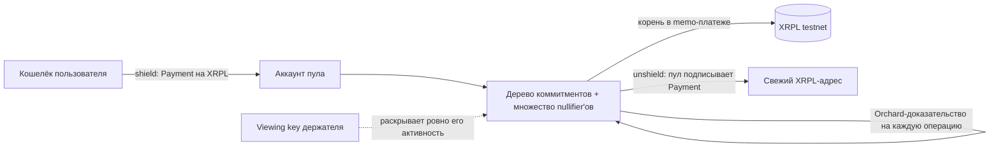

# Confidant — техническая спецификация (русская версия)

> Статус документа: подробная русская редакция [`SPEC.md`](./SPEC.md) по состоянию на
> **2026-10-05** (`main` после PR #5). **Решение от 2026-10-05:** проект переходит к архитектуре
> v2 с минимизацией доверия (§16); §4 и §5 описывают v1 и остаются верными до завершения v2 —
> статус шагов в `ROADMAP.md` §5a. Включает то, что в английском SPEC только задано, а в
> репозитории уже реализовано и проверено аудитом. При расхождениях приоритет у кода, тестов и
> записей в `docs/audit/`. Текущий статус по milestone'ам — в [`ROADMAP.md`](./ROADMAP.md).

---

## 0. Кратко

**Confidant** — комплаентный shielded pool для XRP Ledger. XLS-96 скрывает *суммы*, но граф
переводов (кто кому платил) остаётся публичным. Confidant скрывает *граф*: внутри пула переводы
не оставляют на леджере ни отправителя, ни получателя, ни суммы — только корень дерева
коммитментов, записанный в memo. При этом приватность остаётся **аудируемой по запросу**: ключ
просмотра (viewing key) держателя раскрывает ровно его активность и баланс — и ничего о чужих
операциях.

**Цель:** вживую на testnet показать цепочку **shield → приватный перевод → unshield → раскрытие
аудитору**, где приватный перевод не виден в обозревателе блоков.

**Не-цели:** мультиактивный пул, конфиденциальный AMM, ZKML, проверка доказательств на леджере,
подключение FROST, WASM-доказательства в браузере. Mainnet — только если testnet-демо надёжно.

**Названия.** Формальное имя `Confidant` — для питча, слайдов и всего, что обращено к
институциональной аудитории. Стилизованный логотип `C0nf!d@nt` — только для баннера, демо и
соцсетей. Идентификаторы (репозиторий, крейт, npm) — ASCII `confidant`.

---

## 1. Контекст и ограничения

| Ограничение | Следствие |
|---|---|
| Хакатон AI & Fintech XRP Ledger (Нью-Йорк, 24–25 октября 2026) | Упрощения допустимы; объём фиксирован: одна вещь, сделанная хорошо |
| «Засчитывается только то, что построено на хакатоне» | Ядро (`core/`) — подготовка до события на базе существующей библиотеки (схема Zcash Orchard). Судится XRPL-интеграция, собранная на месте. Об этом разделении говорить честно |
| Testnet first | Все платежи, аккаунты и ключи — testnet. Mainnet — только по решению после надёжного демо |
| Честные формулировки | Нельзя заявлять «полностью анонимно / неотслеживаемо / trustless сегодня». Что именно можно и нельзя говорить — §4 |
| TEE — только сноска о production | Никогда не вести демо через TEE и не ставить его в центр: судьи прошлого хакатона не поверили, что команда понимает TEE. Вести через ZK, которое судьи знают |
| Публичный репозиторий (потенциально) | В git — только роли, никаких реальных имён; никаких ключей, сидов, `.env`, снапшотов |

---

## 2. Роли

| Роль | Зона ответственности | Где в репозитории |
|---|---|---|
| **Крипто/ZK-лид** | Rust-ядро: схема, дерево коммитментов, nullifier'ы, доказательства и их проверка, раскрытие аудитору, публичный лог, snapshot; тесты, покрытие, аудиторский цикл | `core/`, `docs/audit/`, `docs/CORE-API.md`, `docs/E2E.md` |
| **API/XRPL-лид** (владелец репозитория) | HTTP-слой (axum) над ядром, всё XRPL (аккаунт пула, валидация депозитов, анкоринг memo, выплаты, предзаполнение), UI, демо-сценарий, питч | `backend/`, `frontend/`, `scripts/` |
| **Аудит-сессия** | Отвечает на `REQ-*` вердиктами `RESP-*`; не мержит | `docs/audit/` (записи вносит лид дословно) |

---

## 3. Архитектура



Ценность движется только обычными XRPL-платежами в аккаунт пула и из него. Внутри пула
переводы — это изменения состояния «коммитменты нот + nullifier'ы», доказанные с нулевым
разглашением. Корень дерева после каждой операции (или пакета) записывается в memo-платёж, чтобы
любой мог убедиться, что пул не делал двойных трат. Ключ просмотра держателя по запросу
расшифровывает ровно его ноты.

**Вариант проверки — A (выбран):** доказательства проверяются вне леджера (оператором) и
публикуются вместе с «эффектами» операций; корень дерева анкерится на леджере; любой может
переиграть публичный лог и сверить корень. Всё остаётся на XRPL, без EVM/Solidity.

### Потоки

1. **Shield.** Фронтенд отправляет Payment → пул. Бэкенд **проверяет депозит на леджере**
   (валидирован, это Payment, назначение — пул, доставленная сумма совпадает) и только затем
   вызывает ядро: `Pool::shield(owner, amount, depositTxHash)`. Ядро строит и доказывает бандл с
   одним выходом на адрес владельца; коммитмент попадает в дерево.
2. **Приватный перевод.** `Pool::transfer(owner, [{recipient, amount}])`: ядро выбирает
   непотраченные ноты владельца, строит бандл «траты → новые ноты (+ сдача)», доказывает,
   подписывает, проверяет и применяет. На леджер ничего не уходит.
3. **Анкоринг.** Фронтенд читает `GET /pool/state` → `root` и записывает его в memo-платёж от
   аккаунта пула; после подтверждения сообщает ядру `set_anchored_root(root)`.
4. **Unshield.** `Pool::unshield(owner, amount, destination)`: бандл с тратами без внешнего
   выхода, положительный `value_balance = amount`, подписи привязаны к `destination` и сумме.
   Ядро возвращает `payout {amount, destination}`; фронтенд строит и отправляет Payment пул →
   `destination`.
5. **Раскрытие.** `Pool::reveal(viewingKey)`: пробная расшифровка всего лога ключом держателя.

---

## 4. Модель доверия и заявления о приватности

### 4.1 Модель доверия — кастодиальная (заголовок, не сноска)

Оператор (бэкенд) держит **ключи трат всех держателей**, выбирает ноты, строит и подписывает
доказательства. Следствия, которые нужно произносить вслух:

- оператор **видит** все внутренние суммы и адресаты;
- оператор **может потратить или переместить средства любого держателя**;
- **backing обеспечивает оператор, а не криптография**: пул минтит shield со слов фронтенда о том,
  что депозит на XRPL состоялся, и выплачивает unshield так же. Злонамеренный или сломанный
  оператор может сминтить необеспеченный shield, и пул потом честно оплатит unshield против него.

Что при этом **криптографически реально**: каждая операция — настоящее Orchard-доказательство;
любой, у кого есть публичный лог бандлов, может перепроверить каждое доказательство и каждую
подпись и сверить корень с заанкеренным на леджере. Пул не может сделать двойную трату незаметно.

Честная формула для сцены: «сегодня — кастодиально; с бо́льшим временем оператор распределяется, а
TEE выводит его из базы доверия; бездоверительная привязка депозит ↔ минт — это in-enclave
SPV-доказательство, дорожная карта». Это **единственное** место, где упоминается TEE.

### 4.2 Что скрыто, что публично

| | |
|---|---|
| **Скрыто на леджере** | отправитель, получатель и сумма каждого внутреннего перевода; на XRPL попадает только корень в memo |
| **Публично и неустранимо** (любой пул) | суммы и внешние адреса shield и unshield; количество действий в операции (всегда ≥ 2, с паддингом); время |
| **Ограничение — корреляция концов** | пул скрывает *внутренний* граф, но **не** скрывает, что кто-то завёл X и позже кто-то вывел X. При малом или пустом множестве анонимности сумма + время + внешний адрес связывают депозит с выводом. Реальная приватность = размер множества анонимности + фиксированные номиналы + задержка |
| **Пустой пул при запуске** | первые операции имеют ~нулевую приватность. Перед демо пул **предзаполняется** многими testnet-аккаунтами |
| **Что раскрывает ключ аудитора** | ключ аудитора — это **full viewing key держателя**. Он раскрывает **полную активность держателя**: поступления, сдачу, какие ноты потрачены, а также получателей и суммы его *исходящих* переводов — и его текущий баланс. Он не раскрывает ничего о транзакциях, в которых держатель не участвовал. Формулировка «только баланс» неверна |

### 4.3 Что говорить и что не говорить

- **Говорить:** «механизм, скрывающий граф переводов на XRPL, с встроенным комплаенсом;
  масштаб, распределение оператора и TEE — дорожная карта».
- **Не говорить:** «полностью анонимно / неотслеживаемо / trustless сегодня / приватно от
  оператора».

CI проверяет наличие обязательных маркеров этих формулировок в `SPEC.md`/`README.md` и
отсутствие слов-переоценок вне правила «не говорить».

---

## 5. Криптографическое ядро (`core/`, крейт `confidant-core`)

### 5.1 Переиспользуемая схема

«Reused Halo 2 circuits» из английского SPEC — это **Action-схема Zcash Orchard без изменений**:

| Параметр | Значение |
|---|---|
| Крейт | `orchard = 0.15.5`, features `circuit`, `multicore`, `std` |
| Версия бандла | `BundleVersion::orchard_v2()` — пул Orchard с протокольной версией 2 |
| Версия схемы | `OrchardCircuitVersion::FixedPostNu6_2` — схема, работающая в Zcash mainnet с NU6.2 |
| Ноты | V2, шифрование `OrchardDomain` |
| Флаги | траты + выходы + межадресные переводы разрешены (`default_flags()`); shield строится с `SPENDS_DISABLED` |
| Тип бандла | `BundleType::DEFAULT` — транзакционный, паддинг до ≥ 2 действий |
| Ключи доказательства/проверки | строятся из схемы при старте процесса (`ProvingKey::build`, `VerifyingKey::build`), никакого доверенного артефакта ключа |

Почему именно `orchard_v2`, а не `orchard_v3`/`ironwood_v3`: `orchard_v3` запрещает межадресные
выходы (Алиса не сможет заплатить Бобу), `ironwood_v3` нужен только для совместимости с
in-enclave-прувером другого проекта. Аудит: Q-POOL-1, без возражений.

Что схема и бандл гарантируют на каждое действие: принадлежность тратимого коммитмента дереву под
якорем бандла (Sinsemilla-дерево глубины 32); знание ключа трат (`rk` — рандомизированный `ak`,
подпись spend-auth над sighash); корректное выведение nullifier'а; корректный коммитмент выхода;
скрывающие value-коммитменты `cv_net`, которые **binding-подпись** связывает с публичным
`value_balance`. Скрыты: суммы, отправители и получатели внутренних переводов.

### 5.2 Ноты, коммитменты, nullifier'ы, дерево

- **Нота** — Orchard-нота: адрес получателя, значение `u64`, `rho`, `rseed`. Один токен на пул
  (пул агностичен к тому, какой именно).
- **Коммитмент** `cmx` — извлечённый коммитмент ноты (32 байта), лист дерева.
- **Nullifier** `nf` — выводится ключом `nk` держателя из ноты; публикуется при трате. Повтор ⇒
  двойная трата ⇒ отказ.
- **Дерево** — Orchard Sinsemilla Merkle-дерево глубины 32 (`shardtree 0.7`). В дерево
  добавляются **все** `cmx` каждого принятого бандла, включая dummy-выходы (как в Zcash), по одному
  чекпоинту на бандл. Последовательность корней чекпоинтов — **история якорей**; бандл принимается
  только против якоря из истории (нота, засвидетельствованная на старом якоре, остаётся тратимой,
  пока дерево растёт).
- **Множество nullifier'ов** — все `nf` всех принятых бандлов, включая dummy-траты (они случайны
  и безвредны; подобрать dummy под чужой реальный nullifier нельзя без чужого `nk`).

### 5.3 Операции как бандлы

| Операция | Содержимое бандла | `value_balance` | Внешний контекст в sighash |
|---|---|---|---|
| **shield**(owner, amount, depositTxHash) | один выход на адрес владельца, траты отключены (dummy) | `−amount` | `depositTxHash` |
| **transfer**(owner, [(recipient, amount)]) | траты (жадный выбор нот «сначала крупные», свидетели на текущем якоре), выходы получателям (внешняя область адреса), сдача владельцу (внутренняя область) | `0` | нет |
| **unshield**(owner, amount, destination) | траты + сдача, без внешнего выхода | `+amount` | `destination ‖ amount` |

Ограничения: до 8 получателей за перевод (`MAX_OUTPUTS`), суммы > 0, переполнение `u64` при
суммировании — отказ `AmountOverflow`; memo нот — 512 нулевых байт.

### 5.4 Sighash

Сообщение, которое подписывают spend-auth-подписи и binding-подпись бандла:

```
sighash = BLAKE2b-256(personal = "ConfidantSigHash")( bundle.commitment(TxVersion::V5) ‖ op_tag ‖ external_ctx )
```

- `bundle.commitment(V5)` — собственный коммитмент Orchard-бандла: якорь, флаги, `value_balance`
  и публичные части всех действий.
- `op_tag` — 1 байт: shield = 1, transfer = 2, unshield = 3.
- `external_ctx`: shield — `len(hash) ‖ hash`; transfer — пусто; unshield —
  `len(dest) ‖ dest ‖ amount(u64 LE)`, где **`amount` берётся из `value_balance` самого бандла**
  (один источник истины; заявленная вызывающей стороной сумма лишь сравнивается с ним).

Следствие: опубликованное доказательство unshield нельзя перенаправить на другой адрес или сумму,
а бандл одного типа операции нельзя предъявить как другой. Персонализация 16 байт (ограничение
BLAKE2b) даёт разделение доменов с ZIP-244 Zcash.

### 5.5 Хвост верификации (`Pool::verify` → `Pool::submit`)

Чистая проверка (ничего не меняет), по возрастанию стоимости:

1. знак `value_balance` по операции: shield `< 0`, transfer `== 0`, unshield `> 0`
   (`ValueBalanceSign`);
2. если вызывающая сторона заявила сумму: `value_balance == −amount` (shield) / `== amount`
   (unshield) (`ValueBalance`); для transfer заявленная ненулевая сумма — ошибка вызывающей
   стороны (`VouchedAmountNotApplicable`);
3. якорь ∈ истории якорей (`UnknownAnchor`);
4. ни один nullifier не потрачен и не повторяется внутри бандла (`DoubleSpend`) — **до** проверки
   SNARK, чтобы повтор стоил поиск в множестве, а не верификацию доказательства;
5. `verify_proof` (`InvalidProof`);
6. sighash пересчитывается из бандла; проверяется подпись `rk` каждого действия
   (`InvalidSpendAuth`), затем binding-подпись (`InvalidBindingSignature`).

Применение — только после успеха всех проверок и фактически атомарно: добавить все `cmx` +
чекпоинт → записать nullifier'ы → отметить потраченные ноты владельцев → пробно расшифровать новые
ноты для зарегистрированных владельцев → записать бандл в лог. Любая ошибка оставляет пул без
изменений.

Зафиксированное предостережение (аудит, PR #2): порядок «nullifier'ы до доказательства» не даёт
утечки **только пока множество потраченных nullifier'ов публично** (а оно публично через
экспортируемый лог). Если лог когда-нибудь станет приватным, различие ошибок `DoubleSpend` /
`InvalidProof` превратится в оракул «потрачен ли nf» — тогда проверку нужно вернуть после подписей
или сделать ошибки неразличимыми снаружи.

### 5.6 Публичный лог бандлов и независимая перепроверка

Каждый принятый бандл записывается как `BundleRecord` — только публичные эффекты, без плейнтекста
и ключей:

```json
{
  "index": 1, "op": "transfer", "timestamp": 1791193529, "external": "",
  "anchor": "<hex32>", "flags": 3, "valueBalance": 0, "firstLeaf": 2,
  "actions": [ { "nullifier": "<hex32>", "rk": "<hex32>", "cmx": "<hex32>", "cvNet": "<hex32>",
                 "epk": "<hex32>", "encCiphertext": "<hex580>", "outCiphertext": "<hex80>",
                 "spendAuthSig": "<hex64>" }, "…" ],
  "proof": "<hex>", "bindingSignature": "<hex64>"
}
```

Из записи восстанавливается живой бандл (`record::bundle_from_record`), и третья сторона **без
ключей** переигрывает лог в свежий пул через тот же хвост верификации: корень должен совпасть с
заанкеренным, подделанные / повторные / перенаправленные записи отклоняются. Это и есть свойство
перепроверяемости.

### 5.7 Ключи и адреса

- При регистрации владельца (`register_owner(id)`) генерируется случайный `SpendingKey` (32
  байта), хранится в keystore оператора. Выводятся `FullViewingKey`, адрес платежей (внешняя
  область, индекс 0) и адрес сдачи (внутренняя область, индекс 0).
- API получает `OwnerInfo { owner, address (43 байта hex), viewingKey (96 байт hex) }`.
  `viewingKey` — это ключ, который держатель передаёт аудитору при онбординге.
- Аутентификация отправителя (`senderAuth` → `owner`) — ответственность API-слоя; ядро доверяет
  переданному `owner_id`.

### 5.8 Раскрытие (reveal)

`Pool::reveal(viewingKeyHex)`: для каждого действия в логе — пробная расшифровка ключами
просмотра держателя (внешняя и внутренняя области) → входящие ноты; для них по `nk` вычисляется
nullifier и проверяется, потрачен ли; плюс восстановление по `ovk` → исходящие ноты с адресом
получателя. Результат — `RevealReport { balance, notes[] }`, где баланс = сумма непотраченных
входящих нот. Dummy-выходы не расшифровываются ни одним реальным ключом и никому не приписываются.

### 5.9 Персистентность

`Snapshot { format: 1, owners: [{owner, spendingKey}], anchoredRoot, records[] }` —
**содержит ключи трат**; хранится только в gitignored-путях (`*.pool-state.json`, `/data/`).
`Pool::restore` переигрывает лог через тот же `submit`, поэтому восстановленный пул отказывает
ровно в том же, в чём отказал бы исходный; проверяются порядок записей и индексы листьев.

### 5.10 Производительность (ноутбук, release)

| Операция | Время |
|---|---|
| Построение ключей доказательства и проверки (один раз на процесс) | ≈ 2.5 с |
| shield / transfer / unshield (бандл из 2 действий) | ≈ 0.9 с (+ ≈ 0.45 с на каждое доп. действие) |
| Проверка бандла (доказательство + подписи) | ≈ 10 мс |
| Reveal | линейно по числу действий, миллисекунды |
| Пик памяти при доказательстве | ≈ 106 МиБ; доказательство 7264 байта |

---

## 6. Контракт API (Rust-бэкенд ↔ TS-фронтенд)

Все XRPL-транзакции отправляет фронтенд; бэкенд только минтит ноты, доказывает и авторизует.
Типы ответов в ядре — serde, camelCase, возвращаются как есть (`docs/CORE-API.md`).

| Метод и путь | Назначение | Запрос | Ответ |
|---|---|---|---|
| `POST /shield` | после того как фронтенд отправил депозит и бэкенд проверил его на леджере — сминтить ноту | `amount`, `token`, `owner`, `depositTxHash` | `commitment`, `leafIndex`, `newRoot`, `bundleIndex`, `proof` |
| `POST /transfer` | один приватный перевод | `owner`, `outputs:[{recipient, amount}]`, `senderAuth` | `nullifiers[]`, `newCommitments[]`, `newRoot`, `bundleIndex`, `proof` |
| `POST /unshield` | потратить ноты и выйти на XRPL-адрес | `owner`, `amount`, `destination`, `senderAuth` | `nullifiers[]`, `newCommitments[]`, `newRoot`, `bundleIndex`, `proof`, `payout:{amount, destination}` |
| `POST /audit/reveal` | ключ просмотра держателя раскрывает его активность и баланс | `auditorKey` (full viewing key держателя, 96 байт hex) | `balance`, `notes:[{direction, amount, leafIndex, bundleIndex, timestamp, spent, recipient?}]` |
| `GET /pool/state` | публичное состояние, без плейнтекста | — | `root`, `anchoredRoot`, `leafCount`, `nullifierCount`, `bundleCount` |

Служебные вызовы ядра для API-слоя: `register_owner`, `owner_info`, `balance`,
`set_anchored_root(rootHex)` (после подтверждения memo-платежа), `records()` (публичный лог для
публикации), `snapshot()` / `restore()`.

Отображение ошибок ядра в HTTP: `UnknownOwner`, `OwnerExists`, `ZeroAmount`, `AmountOverflow`,
`InsufficientFunds`, `TooManyOutputs`, `VouchedAmountNotApplicable`, `InvalidEncoding` → 400;
`DoubleSpend`, `UnknownAnchor`, `ValueBalance*`, `InvalidProof`, `InvalidSpendAuth`,
`InvalidBindingSignature` → 409/422; `Build`, `Tree`, `NoWitness`, `Snapshot`, `Internal` → 500.

---

## 7. XRPL-слой (API/XRPL-лид)

Образец всех шагов уже есть в `e2e/testnet/run.mjs` (xrpl.js) и может быть перенесён в бэкенд/фронтенд.

- **Аккаунт пула.** Testnet-аккаунт; для демо — один regular key («SignerList-мультисиг / FROST,
  полностью распределённо — в production» как тезис). SignerList — только при запасе времени.
- **Депозит (shield).** Payment пользователь → пул. Перед `POST /shield` бэкенд обязан проверить
  транзакцию по хешу: `validated == true`, `TransactionType == Payment`, `Destination` == адрес
  пула, `meta.delivered_amount` == заявленная сумма. Это шаг backing'а — его строгость и есть
  кастодиальная гарантия.
- **Анкоринг.** После каждой операции (или пакета) Payment от пула на служебный аккаунт (1 drop) с
  Memo `MemoType = "confidant/root"`, `MemoData = root` (hex). После подтверждения —
  `set_anchored_root(root)`. Любой читает memo из обозревателя и сверяет с переигранным логом.
- **Выплата (unshield).** Payment пул → `payout.destination` на `payout.amount`. Свежий адрес
  создаётся самим платежом, если сумма ≥ резерва (на testnet 1 XRP).
- **Предзаполнение.** Скрипт: N faucet-аккаунтов заводят фиксированные номиналы, часть делает
  внутренние переводы, чтобы множество анонимности было правдоподобным и выводы на сцене не
  связывались 1:1 с депозитами.
- **Открытые решения:** XRP или issued/MPT-токен; фиксированные номиналы или произвольные суммы;
  частота анкоринга; где крутится бэкенд на сцене и где лежит snapshot.

---

## 8. Структура репозитория

```
core/            Rust-крейт `confidant-core`: ядро (схема Orchard как зависимость, дерево,
                 nullifier'ы, пруф/верификация, reveal, лог бандлов, snapshot); tests/; examples/
                 (demo, cli — тестовые инструменты)                                   (крипто-лид)
backend/         Rust (axum): 5 эндпоинтов, тонкая обёртка над ядром             (API/XRPL-лид)
frontend/        React/TS + xrpl.js: UI, ссылки на обозреватель, сборка/отправка tx (API/XRPL-лид)
scripts/         faucet-финансирование, предзаполнение пула
e2e/testnet/     e2e-харнес на XRPL testnet (xrpl.js + core CLI)
docs/audit/      записи REQ/RESP дизайн- и impl-ревью, INDEX.md
docs/CORE-API.md контракт ядро ↔ API;  docs/E2E.md — сквозные тесты
.github/workflows/check.yml  CI: fmt / clippy / тесты (release) / покрытие 100% / hygiene / ручной e2e
README.md, SPEC.md, SPEC.ru.md, ROADMAP.md, CLAUDE.md
```

Стек: Rust-ядро и бэкенд; React/TS-фронтенд с `xrpl.js`, которому принадлежит всё XRPL. Без
Solidity, без WASM, без `xrpl-rust`.

---

## 9. Milestones и статус

| Milestone | Критерий готовности | Ядро | API/XRPL/UI |
|---|---|---|---|
| **M0 — подготовка (не судится)** | схема компилируется и доказывает/проверяет; аккаунт пула + N аккаунтов с faucet; скаффолд; API-заглушки | ✅ | ⬜ |
| **M1 — shield** | Payment в пул → `POST /shield` → коммитмент в дереве; `GET /pool/state` показывает новый лист | ✅ | ⬜ |
| **M2 — приватный перевод** | `POST /transfer`: трата → новые коммитменты, доказательство проверяется, nullifier записан, корень сдвинулся; на леджере ничего | ✅ | ⬜ |
| **M3 — анкоринг** | корень записан в testnet memo-платежом; перепроверяем против него | ✅ (хук + replay) | ⬜ (memo-платёж) |
| **M4 — unshield** | `POST /unshield` → доказательство + Payment пул → свежий адрес → средства пришли | ✅ | ⬜ |
| **M5 — раскрытие + демо** | `POST /audit/reveal` показывает активность и баланс одного держателя; минимальный UI ведёт весь сценарий; репетиция на реальном обозревателе | ✅ | ⬜ |

**Критическая зависимость** английского SPEC («схема должна встать без переписывания») **снята**:
пробный пруф прошёл 2026-10-04, запасной план («shield → заанкеренные коммитменты → reveal» без
доказательств переводов) не понадобился.

---

## 10. Definition of done и демо-сценарий

**Готово**, когда вживую на testnet, от начала до конца и с объяснением меньше минуты, показаны:
**shield**, **приватный перевод, невидимый в обозревателе**, **unshield на свежий адрес** и
**раскрытие ровно одного держателя по его ключу**. Всё сверх этого (mainnet, SignerList,
Proof-of-Innocence) — бонус.

Сценарий (~45 секунд), пул предзаполнен, рядом открыт testnet-обозреватель:

1. **Крючок.** «XLS-96 скрывает сумму. Цепочка всё ещё показывает, кто кому платил. Смотрите, как
   мы скрываем и это.»
2. **Shield.** «Алиса заводит 100 в пул — обычный XRPL-платёж.» (в обозревателе депозит)
3. **Приватный перевод.** «Теперь она платит Бобу внутри пула. Вот леджер… ничего. Ни
   отправителя, ни получателя, ни суммы — только корень-коммитмент.» (в обозревателе только memo с
   корнем)
4. **Unshield.** «Боб выводит на свежий адрес. Несвязываемо с депозитом Алисы среди всех участников
   пула.» (в обозревателе пул → свежий адрес)
5. **Главный кадр — выборочное раскрытие.** «Комплаенс: регулятору выдаётся один ключ просмотра.
   Он раскрывает ровно активность и баланс Боба — и ничего больше.» (reveal на экране)
6. **Финал.** «Приватно на XRPL, аудируемо по запросу. Сегодня это пул; вот XLS, который делает
   это нативным.»

Формулировки на сцене обязаны соответствовать §4: кастодиально сегодня, скрыт внутренний граф, а не
концы, ZK в центре, TEE — сноска.

---

## 11. Тестирование и качество

- **Тесты ядра:** 29 (22 интеграционных в `core/tests/{pool,coverage,e2e_demo}.rs`, 7 юнит).
  Негативный набор из дизайн-REQ: двойная трата, повтор, неизвестный якорь, подделанный
  `value_balance`, подмена binding-подписи, испорченный пруф, перенаправленный unshield, подмена
  типа операции, чужая версия схемы, недостаток средств, трата на старом якоре, snapshot/restore
  (nullifier'ы и свидетели переживают перезапуск, порча отклоняется), границы reveal, каждое
  повреждённое поле записи лога.
- **Мутационная проверка каждой защиты:** защита убирается — соответствующий тест краснеет
  (таблицы в `docs/audit/REQ-pool-core-impl-2026-10-04.md`). Пустой негативный тест не считается.
- **Покрытие:** строки 100%, функции 100%, регионы ≈ 97.6% (`cargo llvm-cov`); остаток — ветки
  `Err` у `?` на вызовах библиотеки, недостижимые при инвариантах пула. CI падает ниже 100% строк.
- **CI** (`.github/workflows/check.yml`): `cargo fmt --check`, `clippy -D warnings`, тесты в
  release, покрытие, hygiene (нет файлов-ключей, присутствуют маркеры честных формулировок, нет
  слов-переоценок вне правила), ручной job e2e на testnet (`workflow_dispatch`, отчёт артефактом).
- **E2E, уровень ядра** (`core/tests/e2e_demo.rs`, в CI): весь демо-сценарий — предзаполнение,
  shield, якорь, приватный перевод (публичная запись не содержит ни сторон, ни суммы и неотличима
  по форме от прочих переводов), перезапуск через snapshot, unshield, reveal ровно одного
  держателя (ключ стороннего участника видит только его), переигрывание лога третьей стороной.
- **E2E на XRPL testnet** (`e2e/testnet/run.mjs`): реальные платежи — faucet-аккаунты, депозит
  Алисы с проверкой на леджере перед shield, memo-анкоры после каждой операции и их чтение
  обратно, неизменность `Sequence` аккаунта пула во время приватного перевода, выплата на свежий
  адрес с точным балансом, reveal, переигрывание лога против заанкеренных корней. Эталонный прогон
  2026-10-05 — ссылки в `docs/E2E.md`. Ядро управляется через `core/examples/cli.rs` — тестовую
  замену бэкенда (файл состояния с ключами только в gitignored-путях, права 0600, громкое
  предупреждение; **не использовать как бэкенд**).

---

## 12. Процесс безопасности

Цикл **REQ → RESP** с аудит-сессией (протокол AUDIT-PROTOCOL): `docs/audit/REQ-<slug>-<дата>.md`
от разработчика, `RESP-<slug>-<дата>.md` — вердикт аудита, вносится дословно. Вердикты:
DESIGN-PASS / IMPL-PASS / CONDITIONAL / FAIL. Ни одно изменение ядра не мержится без PASS по своему
срезу; индекс — `docs/audit/INDEX.md`.

Пройдено:

| Единица | Вердикт |
|---|---|
| Дизайн пула (переиспользование Orchard, хвост, sighash, ключ аудитора) | DESIGN-PASS, условия C1–C5 — все выполнены |
| Реализация ядра M0 | IMPL-PASS @ `aba71fe` |
| Перестановка проверки nullifier'ов до доказательства (PR #2) | PASS, с зафиксированным предостережением (§5.5) |
| Покрытие 100% + ужесточение шага 2 хвоста (PR #3) | PASS (с поправкой: `debug_assert!` убран, т.к. его тест пуст в release) |

Условия дизайн-ревью: **C1** кастодиальная модель заголовком («видит всё, может потратить всё,
ручается за backing»); **C2** ограничение корреляции концов; **C3** формулировка про full viewing
key (включая исходящих получателей; «не участвовал», а не «других»); **C4** предупреждение о пустом
пуле; **C5** сумма unshield из единственного источника — `value_balance`.

Зафиксированные инварианты в коде: `external_ctx` ожидает положительный баланс unshield — знак
обязаны проверить все вызывающие (сегодня `verify` шаг 1 и построение бандлов с `withdraw: u64 >
0`); новый вызывающий без проверки знака сделает панику достижимой.

«Вопрос о backing'е» аудита на каждый путь выпуска ценности: назовите инвариант, которым *эта*
сторона связывает выплату с реальным потреблённым депозитом. В этой сборке — ответ «оператор»,
и это записано (§4.1).

---

## 13. Открытые решения и риски

- Токен пула, номиналы, частота анкоринга, место запуска бэкенда — §7.
- Пустой пул = нет приватности первых операций → предзаполнить.
- Корреляция концов при малом множестве анонимности → номиналы + задержка + предзаполнение.
- Кастодиальность должна звучать в питче; любое «trustless» — дефект презентации.
- Стоимость доказательств не риск (§5.10).
- Проверка доказательств не на леджере — по SPEC не-цель; история про нативность — эскиз
  amendment (§15).

---

## 14. Дорожная карта за пределами хакатона

- Идентификатор экземпляра пула (например, корень первого чекпоинта) в персонализацию sighash —
  защита от переноса бандлов между развёртываниями (сейчас их отсекает проверка «якорь ∈ истории»).
- `external_ctx` принимает сумму unshield как `u64`, суженный в точке вызова, — инвариант уходит
  в тип.
- Ограничение истории якорей; аутентификация отправителя внутри ядра; хелпер сохранения snapshot
  только в разрешённые пути как часть ядра.
- Реальная кастодия ключей: распределённый оператор (SignerList / FROST), TEE, in-enclave
  SPV-доказательство депозита — замена «ручается оператор» на криптографию.
- Fixed denominations и Proof-of-Innocence как усиление приватности и комплаенса.

---

## 15. Эскиз amendment (трек Protocol Innovation)

**XLS-96 → Shielded MPT: от конфиденциальных *сумм* к конфиденциальному *графу*.**

- **Разрыв:** XLS-96 шифрует суммы, но прямо оговаривает «нет анонимности отправителя/получателя,
  нет несвязываемости транзакций».
- **Предложение:** расширить MPT (XLS-33) нативным деревом коммитментов и множеством nullifier'ов
  (модель Zcash/MASP) как объектами леджера; перенести модель ключей держателя/эмитента/аудитора из
  XLS-96, чтобы выборочное раскрытие было нативным.
- **Новые примитивы:** `MPTShield`, `MPTTransfer` (nullifier + доказательство), `MPTUnshield`;
  объект `ShieldedMPT` на эмитента с корнем Merkle и множеством nullifier'ов.
- **Модель доверия:** оператора нет — дерево и nullifier'ы ведёт леджер, доказательство проверяют
  валидаторы; ключ аудитора — поле первого класса.
- **Активация:** XLS → amendment → > 80% валидаторов UNL две недели подряд. Работающий пул — то,
  что доказывает жизнеспособность до голосования.
- **Открытые вопросы:** достаточно ли дешёвая система доказательств для проверки на леджере (Halo 2
  против pairing-based SNARK с прекомпилом); хранение/обрезка множества nullifier'ов в объектной
  модели XRPL; постквантовость с первого дня против secp256k1 + миграция.

---

## 16. v2 — архитектура с минимизацией доверия (решение 2026-10-05, в работе)

**Цель.** Уйти от полного доверия одному сервису и достичь децентрализации, **сравнимой** с
Railgun/Tornado на сегодняшнем XRPL. Не лучшей: без amendment никто на леджере не может проверить
доказательство Halo 2, поэтому потолок — федерация k-из-N независимых верификаторов. Срок
реализации — неделя с 2026-10-05.

### 16.1 Четыре функции доверия и как они разделяются

| Функция | v1 (кастодиально) | v2 |
|---|---|---|
| Кто держит ключи трат и видит плейнтекст | оператор | **Wallet** держателя (локальный процесс); верификаторы видят шифротексты, nullifier'ы, коммитменты и доказательства — то же, что видит цепочка в Zcash |
| Кто управляет аккаунтом пула | один regular key | **SignerList k-из-N** независимых верификаторов, master-ключ отключён |
| Кто проверяет доказательства и ведёт состояние | оператор, в памяти | каждый подписант запускает **Verifier**; состояние пооперационно записывается на леджер и восстанавливается кем угодно |
| Кто ручается за backing | оператор | каждый подписант сам проверяет депозит на леджере **и** его привязку к бандлу до подписи; один депозит обеспечивает не более одного shield |

### 16.2 Компоненты

- **Wallet** — ключи, отслеживание своих нот по публичному логу (пробная расшифровка), реплика
  дерева для свидетелей, build / prove / sign. Нативный локальный процесс (WASM на хакатоне не
  делаем), с которым говорит веб-интерфейс через localhost.
- **Verifier** — дерево, множество nullifier'ов, множество потреблённых депозитов, лог бандлов,
  verify-and-apply, кодек memo-анкора, восстановление из memo + зеркала. Ключей не содержит, его
  состояние публично.
- **Координатор** — любая сторона: собирает ≥ k подписей верификаторов под мультиподписными
  транзакциями анкора и выплаты и отправляет их. Может задержать, не может украсть, сминтить или
  подделать трату.

### 16.3 Потоки

- **Shield.** Wallet строит бандл с выходом на свой адрес → вычисляет **хеш бандла** →
  отправляет депозитный Payment с memo `confidant/shield` = хеш → передаёт верификатору
  `{bundle, depositTxHash}`. Каждый подписант: депозит валидирован на леджере (Payment, Destination
  = пул, `delivered_amount == −valueBalance`), хеш из memo равен хешу бандла, депозит ещё не
  потреблён, далее общий хвост верификации; помечает депозит потреблённым; подписывает анкор.
  Привязка через memo закрывает гонку: чужой кошелёк не может предъявить бандл на чей-то депозит,
  потому что депозит обеспечивает только бандл с указанным хешем.
- **Transfer.** Wallet синхронизирует лог, строит траты со свидетелями на известном якоре,
  передаёт бандл; подписанты проверяют и подписывают анкор. На леджер уходит только memo.
- **Unshield.** Бандл + адрес назначения; подписанты проверяют (sighash привязывает адрес и сумму)
  и подписывают выплату и анкор — одним Batch XLS-56, где он включён, иначе сначала анкор.

### 16.4 Memo-анкор на каждую операцию (`confidant/anchor`, ≤ 1 КБ)

```
version(1) ‖ op(1) ‖ root(32) ‖ bundleHash(32) ‖ extLen(1) ‖ ext ‖ n(1) ‖ n × (nullifier(32) ‖ cmx(32))
```

`ext` — 32 байта хеша депозита для shield, ASCII-адрес назначения для unshield, пусто для
transfer. `bundleHash = BLAKE2b-256(personal "ConfidantBundle")` над каноническими байтами бандла
(якорь, флаги, value balance, действия, доказательство, binding-подпись; без метаданных). Бандл из
двух действий — около 230 байт, из восьми — около 620.

Восстановление верификатора кем угодно: прочитать транзакции аккаунта пула → memo → по хешу
получить бандл с любого зеркала (`GET /log`) → проверить хеш и доказательство → применить → корень
должен совпасть с корнем из memo.

### 16.5 Контракт API v2

| Метод и путь | Назначение | Запрос | Ответ |
|---|---|---|---|
| `GET /log?from=N` | публичный лог (зеркало) и состояние | — | `records[]`, `root`, `anchoredRoot`, `leafCount`, `nullifierCount` |
| `POST /submit/shield` | принять клиентский shield после валидации депозита | `bundle`, `depositTxHash` | `Accepted {bundleIndex, firstLeaf, newRoot}` |
| `POST /submit/transfer` | принять клиентский приватный перевод | `bundle` | `Accepted` |
| `POST /submit/unshield` | принять клиентский выход; кворум выплачивает | `bundle`, `destination` | `Accepted` + `payout` |
| `POST /audit/reveal` | удобство поверх публичного лога | `viewingKey` | `balance`, `notes[]` (аудитор может выполнить локально) |

Полей `owner` и `senderAuth` больше нет: авторизацией служат spend-auth-подписи внутри бандла.

### 16.6 Честная формулировка после v2

«Ноты некастодиальны: плейнтекст не покидает клиента, никто другой не может потратить ноты
держателя. Аккаунт пула и проверка доказательств — у кворума k-из-N независимых верификаторов;
состояние восстанавливается из леджера. **Сговор k подписантов может вывести средства пула, но не
может потратить чужие ноты.** Tornado и Railgun проверяют доказательства консенсусом сети; здесь
это невозможно без amendment (§15). Зато у Halo 2 нет trusted setup, который есть у Groth16 в
Railgun.» Ограничения из §4.2 (корреляция концов, пустой пул, объём раскрытия по full viewing key)
остаются в силе.

### 16.7 План на неделю

| Шаг | Что меняется | Кто | Оценка |
|---|---|---|---|
| 1. Ключи и доказательства на клиенте | разделение `Pool` → `Wallet` + `Verifier`; API принимает бандл; привязка депозита через memo | ядро; FE — memo в депозите, localhost-кошелёк | 1 день ядро + 1 день FE |
| 2. Состояние на леджере | кодек memo-анкора, восстановление из memo + зеркала; сканер транзакций пула | ядро; XRPL — сканер | 0.5 + 0.5 дня |
| 3. Кворум через SignerList | SignerList k-из-N, отключение master-ключа, подписанты с собственным состоянием, координатор мультиподписи | XRPL/харнес | 2 дня |
| 4. Открытая ретрансляция | любой верификатор принимает бандлы, `GET /log`, руководство оператора узла | оба | 0.5 дня |

Каждый шаг с изменением ядра — отдельный PR со срезом аудита; дизайн-REQ на всё v2 отправляется до
начала реализации.

## Приложение A. Глоссарий

| Термин | Значение |
|---|---|
| Shield / unshield | ввод в пул обычным платежом / вывод из пула платежом от аккаунта пула |
| Нота | единица скрытой ценности (адрес, значение, `rho`, `rseed`) |
| Коммитмент `cmx` | публичный лист дерева, скрывающий ноту |
| Nullifier `nf` | публикуется при трате ноты; повтор = двойная трата |
| Якорь (anchor) | корень дерева коммитментов на момент построения бандла |
| Бандл | одна операция = набор Orchard-действий + доказательство + подписи |
| Binding-подпись | связывает скрывающие value-коммитменты действий с публичным `value_balance` |
| Sighash | сообщение, которое подписывают spend-auth и binding; привязывает операцию к внешнему контексту |
| Full viewing key | ключ держателя, раскрывающий всю его активность; ключ аудитора |
| Множество анонимности | участники/ноты пула, среди которых неразличим конкретный перевод |
| Backing | обеспечение сминченных нот реальными депозитами на XRPL; здесь — обязанность оператора |

## Приложение B. CLI ядра (тестовый инструмент)

```
cli --state data/x.pool-state.json register <owner>
cli --state ... shield <owner> <amount> <depositTxHash>
cli --state ... transfer <owner> <recipient> <amount>
cli --state ... unshield <owner> <amount> <destination>
cli --state ... reveal <viewingKeyHex> | anchored <rootHex> | state | owner <id>
cli --state ... export-log <file> | verify-log <file>
```

Сборка: `cargo build --release --example cli`. Файл состояния содержит ключи трат в открытом виде;
инструмент пишет его с правами 0600, отказывается работать с путями вне gitignored-шаблонов и
предупреждает об этом при каждом запуске. Это замена бэкенда для харнесов, не продукт.
