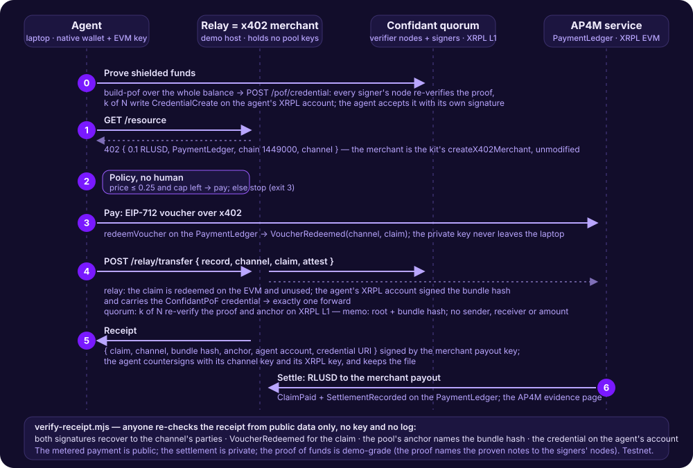

# Confidant × AP4M — "pay for privacy" relay (Mastercard track, hackathon only)

A scripted **agent** pays **RLUSD on XRPL EVM Testnet** (chain 1449000) through Mastercard's AP4M for the **relay** of a
zero-knowledge transfer that Confidant's k-of-N quorum then anchors **on XRPL L1 testnet**. Before it pays, the agent
**proves its shielded funds**: the quorum writes an expiring XLS-70 `ConfidantPoF` credential on the agent's XRPL account
and the relay serves only an account that carries one — machine-to-machine underwriting read from the ledger. After the
anchor, a **receipt** signed by the merchant payout key and countersigned by the agent binds the paid claim, the bundle
hash, the anchor and the credential; `verify-receipt.mjs` re-checks it from public data only. Two ledgers, three facts:
the agent proved funds, the metered payment is public, the settlement of the transfer is private.



**What is and is not touched.** The relay is a fail-closed paywall *in front of* the coordinator's existing
`POST /submit/transfer`. Core, verifier nodes, signer sidecars and the coordinator's trust path are unchanged; the relay
holds no Confidant keys and never signs on XRPL L1 — so no audit slice (ROADMAP §0 ship rule: a read gate, not a signing
path). The relay fee is a **metering fee**, separate from the pool's protocol fee, and not a privacy feature.

**Hackathon-only SDK.** The AP4M kit is licensed "for hackathon use only" and is **not vendored**: `npm install` fetches
`@ap4m/sdk` from the hackathon service and `setup.sh` downloads the two helper files next to the scripts (gitignored).

## Layout

| File | Role |
|---|---|
| `relay.mjs` | x402 Merchant (the kit's `createX402Merchant`, unmodified, sells a static "relay ticket" at `GET /resource`; its store lives in `RELAY_STATE_DIRECTORY`, default `./relay-state`) **+** `POST /relay/transfer { record, channelId, claimId }`: verifies the claim **on-chain** (a `VoucherRedeemed` for that channel and claim at the PaymentLedger, amount ≥ price) and **unused** (spent-set in the state directory), forwards the bundle to the coordinator, returns the anchor. Missing / unknown / reused claim → `402`. The `VoucherRedeemed` scan looks back 200 000 blocks from the chain head (≈ the event's lifetime); an older claim reads as "not found". The spent-set lives on disk per relay process — one relay instance per deployment. |
| `agent.mjs` | Builds a private transfer with the native Confidant wallet (CLI), meets the `402`, applies the **payment policy** (price ≤ `MAX_PRICE_RLUSD`, channel cap remaining), pays with `buyResource` on its Channel, retries with the `claimId`, calls `settle`, prints both explorer links. The operation name is derived from the bundle hash: a rerun resumes, never pays twice. |
| `setup.sh` | `npm install` + download of `ap4m-hackathon-sdk.cjs` and `ap4m-x402.mjs` from the service. |
| `prepare-wallet.mjs` | One-time pool side for the agent: two native wallet files (agent, supplier — keys stay in the state directory), a faucet XRPL account, the entry credential **asked from the pool's demo issuer service** (`ISSUER_URL`, default the coordinator's origin + `/issuer`; falls back to waiting for the issuer's operator) and accepted from here, a shield of `DEPOSIT_XRP`; prints `SUPPLIER` and the agent's private balance. Run 2026-10-25 against the service in a scratch `STATE_DIRECTORY`: credential issued and accepted, 5 XRP shielded, 51 s end to end. |
| `receipt.mjs` | Shared by the three scripts: the receipt statement's canonical JSON (keys sorted; both signatures are over it), the anchor-memo layout (`bundleHash` at bytes 34–66), the `ConfidantPoF` credential's URI and how it is judged. |
| `verify-receipt.mjs` | `node verify-receipt.mjs <receipt.json>`: re-checks a receipt from public data — both signatures recover to the channel's parties, `VoucherRedeemed` for (channel, claim), the anchor sent by the pool with the bundle hash in its memo, the credential on the agent's account. Exit 0 only when all of it holds. |
| `STAGE.md` | The stage sheet: the blind checklist, what a judge can verify and how, the sponsor submission text, the one slide. |
| `env.example` | Every variable; copy to `.env` (gitignored) and fill from the portal. **Never commit keys.** |

## Live run (2026-10-25, testnet, our wallets, the organizers' 20 RLUSD budget)

First the kit's own Demo 1 (sign → `redeemVoucher` → settle) with our wallets, then this relay + agent:

```
[  7853 ms] 402 received: the relay costs 0.1 RLUSD (chain 1449000, ledger 0xcAB42800…)
[ 31771 ms] opened channel 0x758ea328… with a 2 RLUSD cap
[ 31955 ms] policy: price 0.1 ≤ max 0.25 RLUSD, channel redeemed so far 0.0 — paying
[ 45815 ms] paid: claim 0x3e9e70c35b…, VoucherRedeemed https://explorer.testnet.xrplevm.org/tx/0xb9aaa78632e07d33c9c66b3f0a28be92ef160234c515787f2357b9eb30cad7df
[ 59571 ms] relayed: anchored on XRPL L1 — https://testnet.xrpl.org/transactions/533B62011D10B35C6B6DB92F0B4AD50888372DBBBB880D4638F3CA76652B0100 (no sender, receiver or amount in the memo)
[ 68050 ms] settled: payout https://explorer.testnet.xrplevm.org/tx/0x3af20d2ae569bb7ab816d9c75a49df44fae5dc8bfac8d2631088cf9b01f84671; receipt https://hackathon.ap4m.build/public/evidence/claims/…
```

68 s wall from the 402 to the settlement receipt, of which ≈ 24 s is the channel opening (skip it on stage by setting
`CHANNEL_ID` to an open channel), ≈ 14 s the voucher redemption, ≈ 14 s the quorum's anchor, ≈ 8 s the settlement.
A second full run the same morning (fresh bundle, a 0.15-cap channel) anchored `2104CB64…` and settled payout
`0x326f3830…`; the platform caps the number of open channels per team (`ActivePayoutLimitExceeded`), so close the
spares with `closeChannel` and reuse one open channel on stage.

### Run 3 (2026-10-25, 03:57 UTC): proof of funds, payment, relay, receipt, settlement — 92 s

```
[ 11493 ms] proof of funds built: ≥ 16.95 XRP in the pool as of ledger 21803835 (24 h window)
[ 21832 ms] quorum wrote the credential: 2 signers, CredentialCreate https://testnet.xrpl.org/transactions/5D1CAD44377710A4168BEF030CF56A4774DB3948E57C6F85AE989A5D1B3CB684
[ 27835 ms] credential accepted by the agent's account rAMxdUQz71EzKwJVy5QpsvVBUFQAyxiti — CredentialAccept https://testnet.xrpl.org/transactions/166E12584C6F05C338FFB4127396148A2029EE2B7B4CF2A8E5F93E2C8E9ECE9A
[ 34316 ms] bundle built: c08f0db709ea… — a private transfer of 1 XRP inside the pool
[ 34323 ms] 402 received: the relay costs 0.1 RLUSD (chain 1449000, ledger 0xcAB42800…)
[ 35015 ms] policy: price 0.1 ≤ max 0.25 RLUSD, channel redeemed so far 0.1 — paying
[ 47266 ms] merchant not ready (purchase outcome unavailable (HTTP 503); resume the same ope…) — resuming in 5 s
[ 54395 ms] paid: claim 0x8d6d8d5873…, VoucherRedeemed https://explorer.testnet.xrplevm.org/tx/0x50e4d4d0b9ee4fc714f0f6871b97b7894e95b040fab927a7728d1251f1632c99
[ 77746 ms] relayed: anchored on XRPL L1 — https://testnet.xrpl.org/transactions/DC312AEEDAE6947DE09F213C4EE537E8E18119A28A30266D0DC2BE841FD50109 (no sender, receiver or amount in the memo)
[ 77872 ms] receipt: agent-state/receipts/c08f0db7….json — signed by the merchant payout and by this agent (EVM + XRPL); verify: node verify-receipt.mjs …
[ 92420 ms] settled: payout https://explorer.testnet.xrplevm.org/tx/0x20cb8502f9f14ade592bfa878cf8490c11a9f40dfa342704bcf0ed86b67c192f; receipt https://hackathon.ap4m.build/public/evidence/claims/0x8d6d8d58…
```

The proof-of-funds beat costs ≈ 28 s before the 402 (≈ 11 s sync + proof natively, ≈ 10 s for the quorum's
`CredentialCreate`, ≈ 6 s for the agent's `CredentialAccept`); the kit's merchant paused 12 s on a stale chain head
(resumed, nothing paid twice); the quorum's anchor ≈ 23 s; settlement ≈ 15 s. The agent's credential is on
`rAMxdUQz71EzKwJVy5QpsvVBUFQAyxiti` (`account_objects`, type credential, issuer = the pool); the relay's policy was
`MIN_POF_XRP=1`, the agent proved its whole balance.

**Run 4 (2026-10-25, 04:07 UTC) — the stage configuration:** the relay as a service on the demo host behind TLS, the agent
on the laptop (`RELAY_URL=https://confidant.im`, `RESOURCE_URL=https://confidant.im/resource`, an open channel). 80 s wall:
proof of funds ≈ 28 s, voucher ≈ 18 s, relay + anchor ≈ 19 s, settlement ≈ 8 s. VoucherRedeemed
`https://explorer.testnet.xrplevm.org/tx/0x565e3c2adbc6265200ffb25eb8f728e994114f6b50f8f057796bf047342816a1`, anchor
`https://testnet.xrpl.org/transactions/302AB16D2A61C6F221A885C1B13C99B00C9841718805EA5078AC0C56F5FB2554`, payout
`https://explorer.testnet.xrplevm.org/tx/0x6a06e4104258359c40928a85faded20499852968fdc0f975b44ff1639bce437a`;
`verify-receipt` 10/10 ✓ on `receipts/cf18bf64….json`.

What the first attempt taught (all fixed here): the relay's forward to the coordinator can hit a reset connection while
the quorum anchors — the relay must never die on it (guarded handler, retried forward, the claim kept unused on any
failure); a rerun of the agent must **resume** (`pending.json`: same bundle, same purchase name — the kit replays the
paid purchase, nothing is paid twice); the public XRPL EVM RPC occasionally fails a read ("failed to fetch header by
number") — reads are retried; the kit's merchant keeps a SQLite store with a **lock file** in the relay's state
directory — after a crash, delete `merchant.lock` before restarting, and never point two merchants at one directory.
A forward that was applied by the quorum but whose answer was lost shows up on a retry as `409 nullifier already
spent`: the transfer is on the ledger (the pool account's newest anchor memo), only the receipt was lost.

## Run

```bash
cd hackathon/ap4m && ./setup.sh && cp env.example .env   # fill AGENT_PRIVATE_KEY, MERCHANT_*, TEAM_NAME, SUPPLIER …
set -a; . ./.env; set +a
npm run prepare-wallet   # once: the agent's shielded notes on XRPL L1 (asks the pool's issuer service for the entry credential)
node relay.mjs            # :4308 ticket merchant, :4309 relay → COORDINATOR_URL
node agent.mjs            # one run = prove funds → 402 → pay → relay → receipt → settle
node verify-receipt.mjs agent-state/receipts/<bundleHash>.json   # anyone: re-check the receipt from public data
```

**On stage the relay runs on the demo host** as a systemd service behind the site's TLS (`confidant-ap4m-relay`;
its env file holds the merchant keys, its state under the host's data directory; nginx maps `/resource` to the ticket
merchant and `/relay/` to the relay). The agent on the laptop then runs with `RELAY_URL=https://confidant.im`
`RESOURCE_URL=https://confidant.im/resource` (`https://confidant.im/relay/health` is the liveness check). The kit's
merchant requires the resource URL to be exactly `/resource` on an HTTPS origin, which is why it sits at the site root.

Prerequisites: Node ≥ 22.13; the team onboarded (below); `target/release/examples/cli` built; a Confidant wallet file
with shielded notes (`WALLET_FILE`, created with `cli wallet --file … init` and funded by a shield — the e2e harness
shows how).

## Onboarding (what the workshop deck and the portal say)

1. **Register = the organizer's form.** Its "XRPL EVM Wallet Address for Funding" is the team's **funding wallet**: an
   EVM EOA (`0x…`, XRPL EVM Testnet, chain `1449000`) that **signs in** to the team portal ("funding or Agent wallet"),
   **funds the Agent's budget** and **receives what is left after the event**. The guide allows the Agent wallet to be
   the funding wallet, so one EOA can do both; the Merchant payout wallet must differ from it.
2. **Approval auto-provisions and funds 20 RLUSD** (deck: "approve → auto-provision + 20 RLUSD funded"); no booth visit
   is needed for the budget. Gas: XRP from `https://faucet.testevm.ripple.com`.
3. **Sign in** with the funding wallet at `hackathon.ap4m.build/participant`; on *My setup* add the **Agent** wallet (if
   different) and the **Merchant payout** wallet (own EOA — "keep the key, it's how you access your winnings" — or a
   hackathon pool wallet). Note `TEAM_NAME`, `MERCHANT_ID`, the payout address.
4. **Open a channel** (the agent does it with `CHANNEL_CAP`, or pick an open one as `CHANNEL_ID`), then pay.

Walk-in sign-up (no form answered) needs a connected browser wallet that signs the sign-up message; staff approve.

## Demo (a 5-minute slot; the flow itself in under 3 — the deck's "what a strong demo proves": control, payment, proof)

0. **Prove.** Terminal: "proof of funds built: ≥ X XRP in the pool", "quorum wrote the credential: 2 signers",
   "credential accepted by the agent's account". Say: "before it may pay, the agent proves it controls shielded funds —
   not to us, to the quorum; the credential sits on its XRPL account and the relay reads it from the ledger. A snapshot,
   not a lock; demo-grade, because the proof names the proven notes to the signers' nodes."
1. **Control.** "Two verified parties: the agent is registered in AP4M's registry (KYA), the merchant is our relay; the
   channel has a funded cap." Terminal: wallet synced, bundle built. "This agent holds shielded funds on the XRP Ledger
   and needs to pay a supplier without publishing it. Privacy is a metered service: it pays per relay, in RLUSD."
2. **Payment.** The `402` and the policy line: "it reads the price, checks its channel, decides to pay — no human."
   Voucher signed; the relay releases the resource at once.
3. **Proof.** EVM explorer: `VoucherRedeemed` at the PaymentLedger; then XRPL testnet explorer: the pool account's new
   anchor Payment — no sender, no receiver, no amount. "Two ledgers, two receipts."
4. **Settlement and the receipt.** `settle` → RLUSD to the merchant payout (`ClaimPaid` + `SettlementRecorded`), the
   receipt URL; then `node verify-receipt.mjs agent-state/receipts/<bundleHash>.json` — every line ✓ from public data:
   both signatures, the redeemed voucher, the pool's anchor naming the bundle hash, the credential on the agent's
   account. Say: "you do not have to believe the relay; the receipt is checkable by anyone."
5. **Over-cap attempt rejected.** Run the agent once more with `CHANNEL_ID` set to the 0.15-cap channel that already
   paid once: it meets the 402, reads the channel and stops — rehearsed 2026-10-25: *"policy: channel has 0.05 RLUSD
   left < price — NOT paying"* (exit code 3, nothing signed). The ledger would refuse the voucher anyway
   (`settled ≤ redeemed ≤ cap`). Say: "the limit is funded and enforced by the contract; the agent only decides inside
   it." (`OVER_CAP_DEMO=1` does the same check right after a successful relay on a 0.15 channel.)

Judging (deck): real-world utility 25 %, trust & control 25 %, technical execution 25 %, path to production 15 %,
demo & story 10 %. The web guide's rubric adds: autonomy (the agent reads the 402 and decides), use-case clarity (the
payment is load-bearing), on-chain proof (`VoucherRedeemed` at the PaymentLedger), RLUSD settlement (the payout wallet's
balance changed), demo quality (live, no recordings, the flow in 3 minutes), creativity.

**Path to production (one paragraph for the judges).** The relay is a metered gateway in front of an API that already
runs on testnet with a k-of-N quorum; the same x402 exchange works against AP4M's production rails when they exist. The
pool side keeps its own path (`ROADMAP.md`): RLUSD *inside* the pool (deposit/payout for issued tokens), the signing
path's subject-consent binding, and on-ledger verification when XRPL offers it. The relay fee would become the
operators' revenue line, separate from the pool's protocol fee.

Fallbacks: AP4M side down → the pool demo (`docs/DEMO.md`) plus the rehearsal receipts, said plainly; EVM faucet dry →
the pre-funded rehearsal wallets; channel exhausted → the second channel opened in advance.

## What is enforced, where — and what is not

The sponsor's payment ledger cannot be the enforcer of "this claim paid for this bundle": the kit fixes the resource URL
at `/resource` with static content and derives a claim id from the voucher (channel, cumulative amount) only, so the
payment carries no bundle hash. The binding is therefore ours, and it is enforced in code and by the verifier:

| Rule | Enforced by | How |
|---|---|---|
| One forward per claim | relay | a persisted spent-set (`spent-claims.json` in the relay's state); a claim that already bought a forward is refused with `402` |
| Paid before forwarded | relay | `VoucherRedeemed(channel, claim)` read on the EVM, the claim's amount ≥ the price; refusal = `402`, claim unspent |
| Underwritten before forwarded | relay | `attest`: the key belongs to the account, the signature over the bundle hash verifies, the account carries the pool's `ConfidantPoF` credential (issuer = the pool from `/config`, accepted, unexpired, URI understood, X ≥ `MIN_POF_XRP`); refusal = `403`, claim unspent |
| No receipt for another bundle | relay | after the anchor, the bundle hash in the quorum's memo must equal the attested one, else `receipt: null` with the reason |
| The receipt's signer is the merchant | agent | the signature is recovered and compared with the channel's payout address on-chain before the agent countersigns; the relay itself refuses to start if `MERCHANT_PAYOUT_KEY` is not the key of `MERCHANT_PAYOUT` |
| Everything above, by anyone | `verify-receipt.mjs` | both signatures recover to the channel's two parties; `VoucherRedeemed` for (channel, claim); the anchor sent by the pool account with the bundle hash in its memo; the credential with that URI on the agent's account; exit 0 only then |

**Not enforceable, said plainly.** A relay that takes a claim and never forwards: ordinary merchant non-delivery under
x402 — the agent is left with a redeemed voucher and no receipt, which is the evidence. The threshold is a solvency
signal, not coverage of the transfer: the relay never sees the amount. The proof of funds is a snapshot ("controlled ≥ X
as of ledger L"), never "controls it now".

**Hardenings not done (each ≈ 10 lines, one more live run):** (1) include the claim id and channel id inside the agent's
signed attestation, so it reads "this account authorizes claim X to pay for bundle Y" and cannot be replayed with
another claim — today a replay buys nothing (a bundle anchors once), so this is hygiene, not a hole; (2) a signed quote
`{claim, bundle hash}` from the relay *before* it forwards, so non-delivery would be provable as the merchant's broken
commitment rather than an absence.

**`/resource` in a browser** redirects to the how-it-works page's Mastercard section (nginx: no `X-AP4M-CHANNEL-ID`
header → `302`); agents always send the header and reach the kit's merchant.

## Honest labels

Hackathon SDK on a testnet with testnet RLUSD. The agent's entry credential comes from the pool's demo issuer — KYC in demo mode: the gate the nodes enforce is the real, working system; the issuer's admission policy in the demo is open registration (any account that asks, rate-limited — as an exchange opens an account first and KYC lifts its limits); a real deployment applies its own issuer policy to the same gate. The proof of funds is **demo-grade** (the project's ruling of 2026-10-25):
the proof reveals the proven notes' nullifiers to the signers' nodes, so the agent's later spend of those notes is
linkable by the quorum — here the paid transfer spends them right away; the credential says "controlled ≥ X as of ledger
L", never "controls it now". The receipt binds the relay's own forwarding to the payment and the credential; the quorum's
acceptance is attested by the anchor's k signatures, not by the receipt. The pool account is federated (k-of-N): collusion of k signers can drain the
pool account, never spend a note; shield/unshield endpoints are public; an empty pool has no privacy. RLUSD **inside** the
pool is roadmap — the core is token-agnostic, the deposit/payout surface for issued tokens is not built; never say "RLUSD
support". On the AP4M side the Agent key stays with the team; the RLUSD budget sits in AP4M's escrow vault and the AP4M
service executes settlement — their design, said plainly if asked.
